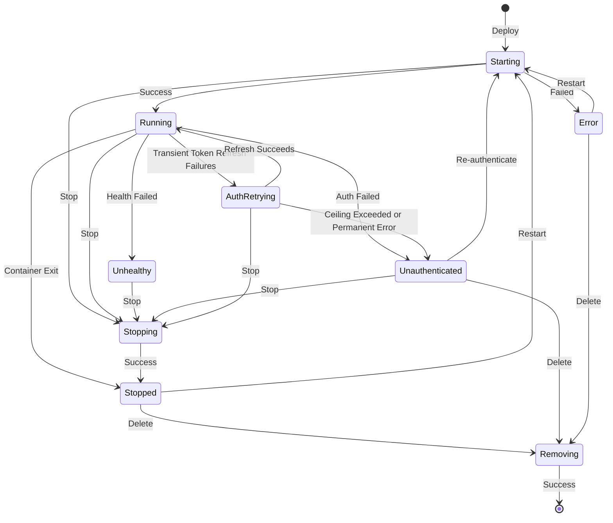

# Workloads Lifecycle Management

The workloads API provides a unified interface for managing MCP server deployments across different runtimes. This document explains how workloads are created, managed, and destroyed.

## Overview

The workloads manager abstracts lifecycle operations across:
- Local Docker/Podman deployments
- Remote MCP servers
- Kubernetes deployments (via operator)

**Implementation**: `pkg/workloads/manager.go`

## Workload Lifecycle



**States**: `pkg/container/runtime/types.go`
- `starting`, `running`, `stopping`, `stopped`
- `removing`, `error`, `unhealthy`, `unauthenticated`, `auth_retrying`
- `policy_stopped`, `unknown`

The `auth_retrying` cadence and ceiling can be tuned via environment
variables on the proxy process:

- `TOOLHIVE_TOKEN_AUTH_RETRYING_TICK_INTERVAL` (default `10m`): cadence
  between background refresh attempts during the AuthRetrying window.
- `TOOLHIVE_TOKEN_AUTH_RETRYING_MAX_ELAPSED` (default `24h`): ceiling
  before the workload is finally marked `unauthenticated`.

## Core Operations

### Deploy

**Foreground:**
```bash
thv run my-server --foreground
```

Creates transport → deploys container → starts proxy → blocks until shutdown

**Detached:**
```bash
thv run my-server
```

Saves state → forks process → returns immediately → child runs in background

**Implementation**: `pkg/workloads/manager.go`

### Stop

```bash
thv stop my-server
```

**Container workload**: Stops proxy process → stops container → preserves state

Stopping a workload by name always cleans up its proxy and asks the runtime to
stop the container, even when the container has exited or is gone. This stops a
supervisor that is waiting in restart backoff. Auxiliary workloads have no proxy
to clean up.

Stop writes `Stopping` and then `Stopped`, and removes client configuration,
only when something was live: the container was running or the recorded PID is
the workload's running supervisor. Otherwise stop leaves the current status
alone, so an `Error` or `PolicyStopped` workload keeps its status and reason,
even if a stale PID is still recorded. If the recorded PID is alive but can't be
inspected, stop fails instead, because it can neither signal that process nor
know that it has stopped. See [Proxy termination](#proxy-termination).

`thv stop --all` and `--group` skip `Starting` workloads, including supervisors
waiting in restart backoff. Stop them by name.

Stop keeps the saved run configuration, but a foreground `run` deletes its
workload when it exits. Stop waits at most five seconds for the supervisor to
exit, so it can return before that cleanup finishes. Before it writes the final
status, stop checks that the saved configuration still exists, and skips the
write if it is gone. The check and the write are not atomic, so a concurrent
delete can still race with stop. Stop does not create status for a name it
doesn't know.

**Remote workload**: Stops proxy → preserves state

Stop moves a remote workload from `Running`, `Starting`, `AuthRetrying`,
`Unauthenticated`, or `Unhealthy` to `Stopped`, with the same saved
configuration check. Other statuses are left alone.

**Implementation**: `pkg/workloads/manager.go`

### Start

```bash
thv start my-server
```
> Note: `thv restart` remains available as an alias for backward compatibility.

Loads state → verifies not running → starts workload with saved config

**Implementation**: `pkg/workloads/manager.go`

### Delete

```bash
thv rm my-server
```

**Container workload**: Stops proxy → removes container → deletes state

Delete stops the supervisor before it removes the container. If the container
lookup finds nothing but a saved run configuration exists, delete still asks the
runtime to remove the workload, because a supervisor in backoff can create the
container again. If that removal fails and the container still can't be found,
delete logs the error and cleans up the saved state. If the container now
exists, delete returns the error and keeps the saved state so you can retry. A
name with no container and no saved run configuration skips runtime removal.

Delete uses the container's runtime name when it finds one, then the saved
`ContainerName`, then the workload name.

The Docker runtime only deletes networks that carry the `toolhive=true` and
workload name labels. It leaves unlabelled networks alone, even when their
names match ToolHive's naming scheme.

Delete fails, sets the status to `Error`, and keeps the container and saved
state if the supervisor can't be confirmed gone: it is still running after
being killed, or its recorded PID is alive but can't be inspected.
Retry once the supervisor has exited. See
[Proxy termination](#proxy-termination).

**Remote workload**: Stops proxy → deletes state

**Implementation**: `pkg/workloads/manager.go`

### Upgrade

```bash
thv upgrade check [my-server]      # offline metadata comparison, never pulls
thv upgrade apply my-server --yes  # verify + pull, then recreate
```

Upgrades apply only to **registry-sourced** workloads — those run by a registry entry name, which records `RunConfig.RegistryServerName`. A workload run from a raw image reference has no registry server name and is reported as `not-registry-sourced`.

**Check** is an offline comparison. The checker (`pkg/workloads/upgrade.Checker`) looks up the workload's `RegistryServerName` in the configured registry and compares the running image tag against the candidate the registry advertises (semver, conservative: a `latest` tag, a different repository, or non-comparable tags yield `unknown`). When the registry advertises a strictly newer tag the status is `upgrade-available`, and the result also surfaces **env-var drift** (variables the candidate now declares that the workload does not yet supply) and **posture drift** (transport, permission profile — network isolation is a local-only choice the registry cannot express, so it is not reported as drift). Checks never pull images.

**Apply** is the single security-critical path (`pkg/workloads/upgrade.Applier`). It re-derives the check against the registry on every apply (closing the time-of-check/time-of-use window — a `CheckResult` from an earlier `check` is never trusted), then, in order:

1. Resolves and **verifies** the candidate image's provenance (by registry server name).
2. Builds a merged `RunConfig` that **preserves the entire user configuration** — env vars, secrets, OIDC/authz/audit/telemetry, tool filters, middleware, transport/posture — and changes only the image, any merged env/secrets supplied via `--env`/`--secret`, and the registry source URLs.
3. Runs the policy gate and performs the verified **pull**.
4. Only then asks the manager to recreate the workload via `UpdateWorkload` (stop → delete → start with the new config).

Steps 1–3 all complete before any destruction, so a failure while preparing the candidate leaves the running workload untouched. **There is no automatic rollback**: once recreation begins, the previous image/config is not restored — recovery is a forward operation. Posture drift (transport, permission profile) is **surfaced as a warning, not converged**: the upgraded workload keeps its full existing posture, including transport, network isolation, and permission profile.

> Runtime boundary: the "verified pull before destruction" guarantee holds precisely for local container runtimes (the scope here). On Kubernetes the verification and policy gate still precede recreation, but the byte-level pull is delegated to the kubelet and happens after recreation.

The same `Applier` backs both the CLI (`thv upgrade apply`) and the API (`POST /api/v1beta/workloads/{name}/upgrade`, with `GET .../{name}/upgrade-check` and `GET .../upgrade-check` for single and bulk checks), so the verify-then-pull ordering lives in exactly one place. `thv list --check-upgrades` annotates the workload list with each workload's check result.

**Implementation**: `pkg/workloads/upgrade/`, `cmd/thv/app/upgrade.go`

### Proxy termination

Before signalling the PID in the status file, stop and delete check that it
belongs to this workload's ToolHive supervisor. A detached supervisor must have
the exact workload name on its command line. A foreground supervisor must be a
`thv` process whose subcommand, the first argument that is not a flag, is
`run`, `start`, or `restart`. Only the ToolHive arguments before `--` are
checked, because everything after `--` goes to the MCP server.

- `start` and `restart` must have the workload name as a whole argument, unless
  they select workloads with `--all`/`-a` or `--group`/`-g`.
- `run` must have `--name <workload>` or `--name=<workload>`. A `run` without
  `--name`, such as `thv run <image>` or `thv run --from-config <file>`, is
  accepted without a name, because its name comes from the image or the file.

There is no process start-time check, so if the OS reuses the PID for another
matching `thv` command, ToolHive can't tell. A recorded PID is never signalled
unless it passes this check:

- A process that was inspected and doesn't match, for example after the OS
  reused the PID, is left alone and its PID stays recorded. Stop and delete
  carry on as if no supervisor were running.
- A process that is alive but can't be inspected, for example because it
  belongs to another user, makes stop, delete, start, and restart fail with an
  error. It could still be the supervisor, and ToolHive won't report success
  while it may be restarting the container.
- A PID whose process has exited is cleared.

On Unix, ToolHive sends SIGTERM. On Windows, it uses TerminateProcess, which is
a hard stop. Either way it waits up to five seconds for the process to exit.
A supervisor's shutdown stops its containers one at a time with the runtime's
stop timeout, so it can take a minute when a container ignores SIGTERM. Stop
carries on and leaves it to finish. Delete, start, and restart can't overlap
with that shutdown, so they kill a supervisor that is still exiting (SIGKILL on
Unix), wait up to five more seconds, and fail if it is still running. Delete
then removes the containers itself, and start and restart replace them.

If there is no PID to signal, or the process doesn't match, stop and delete
fall back to freeing the proxy port when the saved configuration allows
it. The port holder must match the workload exactly, and the fallback also
waits up to five seconds. This fallback is best-effort and can leave a proxy
running or its port in use.

The supervisor owns its PID entry. It keeps the PID registered across container
restart attempts, including backoff, and shutdown cancels the backoff. When it
exits, it clears the PID only if the entry still holds its own PID. If it was
cancelled, by a signal or by reaching a deadline, it exits with status 0, and
under one status file lock clears its PID and changes `Starting` or `Running` to
`Stopped`. It writes nothing unless the recorded PID is its own, so a
replacement that has written `Starting` but not yet recorded its PID keeps its
status.

Start and restart stop any other supervisor whose PID is recorded for the
workload before they spawn a new one, whatever the current status is. They
return an error, without spawning, unless that supervisor is confirmed gone.
They never signal their own PID. A foreground `thv run` is the exception: it
deletes its workload when it exits, so start and restart leave it in charge and
return success without doing anything, including while it waits in restart
backoff. These rules apply to container and remote workloads.

**Implementation**: `pkg/workloads/manager.go`, `pkg/process/toolhive_proxy.go`

### List

Listing combines container workloads from the runtime with remote workloads from persisted state. The manager can filter workloads by label or group, and can optionally include stopped workloads.

**Implementation**: `pkg/workloads/manager.go`

## Batch Operations

Some operations (stop, delete) support processing multiple workloads in a single invocation, handling each workload sequentially or in parallel as appropriate.

**Pattern**: Operations return a `CompletionFunc` (call to block until completion); internally uses `golang.org/x/sync/errgroup`

**Timeout**: 5 minutes per operation

## Container vs Remote

### Container Workloads

**Components:**
- Container (via runtime)
- Proxy process (detached mode)
- Permission profile
- Network isolation

**Available operations:** All

### Remote Workloads

**Components:**
- Proxy process only
- No container
- No permission profile

**Available operations:** Deploy, stop, restart, delete, list

**Detection**: `RunConfig.RemoteURL != ""`

**Implementation**: `pkg/workloads/manager.go`

## State Management

### Storage Locations

**RunConfig state:**
- Path: `$XDG_STATE_HOME/toolhive/runconfigs/<name>.json`
- Default: `~/.local/state/toolhive/runconfigs/<name>.json`
- Contains: Full RunConfig
- Used for: Restart, export

**Status file:**
- Path: `$XDG_DATA_HOME/toolhive/statuses/<name>.json`
- Default: `~/.local/share/toolhive/statuses/<name>.json`
- Contains: Status, PID, timestamps
- Used for: List, monitoring

**PID file** (container workloads only):
- Path: `$XDG_DATA_HOME/toolhive/pids/toolhive-<name>.pid`
- Default: `~/.local/share/toolhive/pids/toolhive-<name>.pid`
- Contains: Proxy process PID
- Used for: Stop operation

**Implementation**: `pkg/state/`, `pkg/workloads/statuses/`

### Status Manager

Provides atomic status updates:
- `SetWorkloadStatus` - Update status
- `GetWorkload` - Read status
- `SetWorkloadPID` - Set PID
- `DeleteWorkloadStatus` - Remove status

**Implementation**: `pkg/workloads/statuses/file_status.go`

## Labels and Filtering

### Standard Labels

The system automatically applies standard labels to workloads:
- `toolhive-name` - Full workload name
- `toolhive-basename` - Base name without timestamp
- `toolhive-transport` - Transport protocol type
- `toolhive-port` - Proxy port number

**Implementation**: `pkg/labels/`, `pkg/runner/config.go`

### Custom Labels

Users can apply custom labels for organizational purposes. Labels support filtering during list operations.

**Implementation**: `pkg/workloads/types/labels.go`

## Related Documentation

- [Core Concepts](02-core-concepts.md) - Workload concept
- [Deployment Modes](01-deployment-modes.md) - Lifecycle per mode
- [Transport Architecture](03-transport-architecture.md) - Transport lifecycle
- [Groups](07-groups.md) - Group operations
