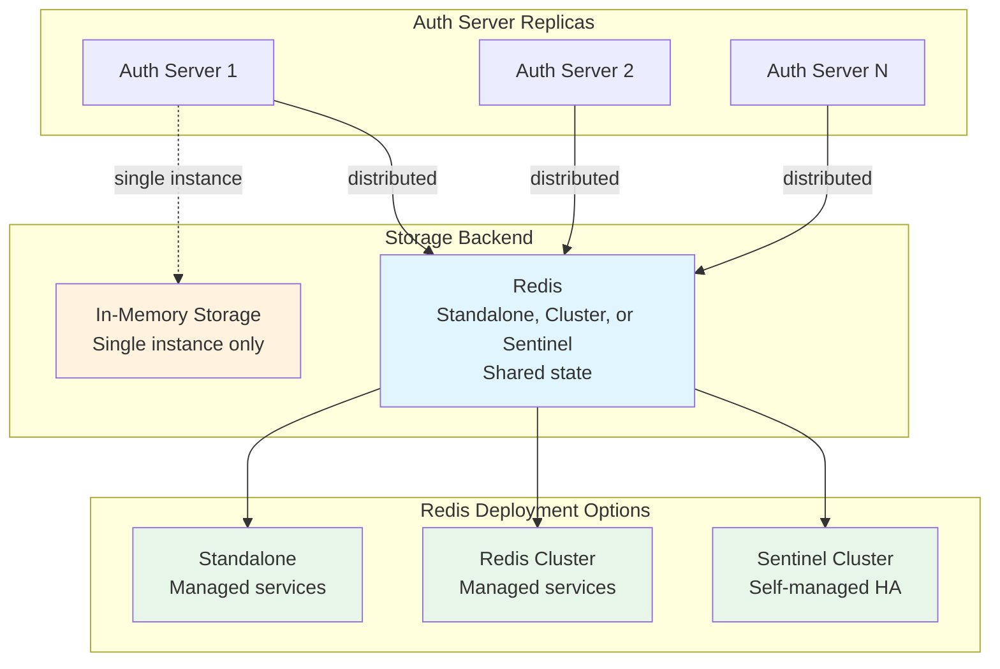

# Auth Server Storage Architecture

The embedded authorization server uses a pluggable storage backend to persist OAuth 2.0 state. This document describes the storage architecture, the available backends, and the Redis Sentinel implementation.

## Overview

The auth server stores OAuth 2.0 protocol state including access tokens, refresh tokens, authorization codes, PKCE challenges, client registrations, user accounts, and upstream IDP tokens. Two storage backends are available:

1. **Memory** (default): In-process storage with mutex-based concurrency. Suitable for single-instance deployments.
2. **Redis**: Shared storage backed by Redis. Supports standalone mode (single endpoint, suitable for managed services like GCP Memorystore Basic and AWS ElastiCache without cluster mode), Cluster mode (Redis Cluster discovery endpoint, e.g. GCP Memorystore Cluster and AWS ElastiCache with cluster mode enabled), and Sentinel mode (high-availability with automatic failover). Required for horizontal scaling across multiple auth server replicas.



## Storage Interface

The storage layer implements multiple interfaces from the [fosite](https://github.com/ory/fosite) OAuth 2.0 framework, plus ToolHive-specific extensions:

**Fosite interfaces:**
- `oauth2.AuthorizeCodeStorage` — Authorization code grant
- `oauth2.AccessTokenStorage` — Access token persistence
- `oauth2.RefreshTokenStorage` — Refresh token with rotation
- `oauth2.TokenRevocationStorage` — Token revocation (RFC 7009)
- `pkce.PKCERequestStorage` — PKCE challenge/verifier (RFC 7636)

**ToolHive extensions:**
- `ClientRegistry` — Dynamic client registration (RFC 7591)
- `UpstreamTokenStorage` — Upstream IDP token caching with user binding
- `PendingAuthorizationStorage` — In-flight authorization tracking. Interactive requests have a single-use `awaiting` consent stage before upstream login; only an `approved` record can complete a callback. Each `PendingAuthorization` carries a `BrowserBindingHash`, the SHA-256 of a random cookie value set on the user agent. The consent POST and `/oauth/callback` require the matching cookie before consuming their respective records. Only the hash is stored; an older row without a binding or approval stage cannot complete the flow and must be restarted. `PendingDeviceLogin` carries the same browser binding for the separate device-flow verification-page login, which shares `/oauth/callback`.
- `RememberedConsentStorage` — Optional server-side browser sessions and one approval per `(userID, clientID)`. The browser holds only a random `__Host-thv_consent_<sha256>` secret; storage holds its SHA-256 digest. Each approval records the redirect URI, scopes, and resource selected for that client. Memory and Redis implement this capability; decorators expose the underlying backend via `storage.Unwrap`. See [Interactive client approval](#interactive-client-approval).
- `UserStorage` — Internal user accounts and provider identity linking
- `DCRCredentialStore` — DCR client metadata and credential persistence; intentionally NOT embedded in `Storage` (each backend implements it separately and call sites reach it via an explicit `stor.(DCRCredentialStore)` type assertion). Secret-based clients store hashed secrets; `private_key_jwt` clients store their inline public JWKS and signing algorithm. Outbound (upstream) registrations resolved by `pkg/auth/dcr` are keyed by `(Issuer, UpstreamID, RedirectURI, ScopesHash)` plus the optional operator-set `dcrConfig.rotationKey`. Changing the rotation key addresses a new row, so the next start registers a fresh upstream client; the previous row stays in place and carries no TTL unless the upstream asserted `client_secret_expires_at`. On a cache hit the resolver also checks the cached client against the upstream and replaces the row when the upstream rejects it, provided the store implements `dcr.Replacer`. `dcrConfig.registrationProbe` selects the check: `tokenEndpoint` (default) redeems a random authorization code and reads `invalid_client` as "gone"; `authorizationEndpoint` sends an authorization request without following redirects and reads a direct 400/401/403 carrying an RFC 6749 JSON error object with `error` `invalid_client`, `unauthorized_client` or `invalid_request` as "gone" (RFC 6749 §4.1.2.1); `none` skips the check. Each setting has a blind spot the rotation key covers: `tokenEndpoint` misses an upstream that validates the grant before authenticating a public client (it then answers `invalid_grant` for any client_id) and skips `private_key_jwt` clients, which it cannot sign for; `authorizationEndpoint` misses an upstream that renders its unknown-client error with 200, a redirect, or a page rather than a JSON error object; with `none` the rotation key is the only way to retire a registration. A false rejection by either probe re-registers at every start and, when registration also fails, fails startup. The check runs at start; `dcrConfig.registrationProbeInterval` (a Go duration of at least `1m`) repeats it while the server runs. Each tick re-runs the resolution against the stored row: a rejected registration is replaced, a missing one is registered, and when the result names a different client than the one in use, including a row another replica replaced, the upstream provider switches to it in place (`upstream.ClientCredentialsUpdater`; OIDC providers also replace their ID token verifier). A failed tick is logged and leaves the provider on its current client. An authorization started under the previous client and completed after the switch redeems its code with the new client, and upstream refresh tokens bound to the previous client stop refreshing, as with a restart. Each tick sends at most one probe request to the upstream from every replica (none with `registrationProbe: none`), plus a registration request when the probe rejects the client; the `tokenEndpoint` probe appears in upstream logs as a failed code redemption, so an interval of 5m to 15m suits most upstreams. Endpoints the run config leaves to discovery follow the new registration, and each replica waits a random part of the interval before its first tick and the interval ±10% after that.
- `AssertionJWTConsumer` — atomic single-use consumption for validated JWT assertions. It is deliberately separate from `Storage`, so only assertion-grant composition requires replay protection.

**Implementation:**
- Interface definitions: `pkg/authserver/storage/types.go`
- Memory backend: `pkg/authserver/storage/memory.go`
- Redis backend: `pkg/authserver/storage/redis.go`

## Upstream subject identifiers in access tokens

The auth server can optionally include an RFC 9493 `sub_id` claim for access tokens issued after an upstream OIDC login through the authorization-code or device flow, including access tokens minted from their refresh tokens (not token exchange, jwt-bearer, or client credentials). The claim uses the issuer and subject from the validated upstream ID token:

```json
"sub_id": {
  "format": "iss_sub",
  "iss": "https://identity.example.com",
  "sub": "upstream-subject"
}
```

Together with `sub_id`, the auth server sends a second claim that a consumer can key on across upstream app registrations. Its name, `https://toolhive.dev/upstream_subject`, is a collision-resistant (public) claim name under RFC 7519 section 4.2:

```json
"https://toolhive.dev/upstream_subject": {
  "iss": "https://login.microsoftonline.com/<tenant-GUID>/v2.0",
  "claim": "oid",
  "value": "<the user's oid>"
}
```

- `iss` is the validated issuer of the upstream ID token, the same value as `sub_id.iss`.
- `claim` is the upstream's `subject_claim` setting, or `"sub"` when the setting is not set.
- `value` is that claim's value from the same validated ID token. It is the value ToolHive already uses to key its own local user.

The claim is sent only when `sub_id` is sent, under the same setting. It is present for every OIDC upstream, also when `claim` is `"sub"` and `value` repeats `sub_id.sub` (Okta, Google, Keycloak). A consumer therefore always reads one claim, and the claim keeps the same structure when an operator sets `subject_claim` later (its values still change; see below). A consumer that needs an identifier that stays the same across upstream app registrations should key on (`iss`, `claim`, `value`), not on `sub_id`.

Rules for consumers:

- Compare all three members as exact strings. Never compare `value` alone: the same person has a different `iss` for Entra v1 and v2 endpoints, for an Okta org and a custom authorization server, and for custom URL domains.
- Allowlist the (`iss`, `claim`) pairs you accept, for example (`https://login.microsoftonline.com/<tenant-GUID>/v2.0`, `oid`), and fail closed on any other pair. Use the exact `iss` string that appears in the upstream ID token.
- Treat the value as an ownership key only when `claim` names an immutable identifier that the IdP never assigns to another person, such as `sub` or Entra `oid`. `email`, `preferred_username`, `upn` and `unique_name` can be reassigned to another person, who would then inherit the previous owner's sessions. Microsoft documents Entra `email` as mutable and not guaranteed to be correct.

`subject_claim` is not restricted by the auth server. The same value already keys the local user, so this adds no new risk inside ToolHive, but a consumer that trusts the exported key must apply the allowlist above.

This identifies the same user as the token's existing ToolHive `iss` and `sub`; those outer claims do not change. Pure OAuth2 upstreams (including those that resolve identity through userInfo or identityFromToken) and synthetic identities never receive `sub_id` or the upstream subject claim. A later upstream login in a multi-provider chain does not replace or fill in the identity established by the first login.

Disclosure is disabled by default. Only Go code that embeds the auth server can enable it:

- Callers of the embedded auth server runner pass `runner.WithSubjectIdentifierAudiences`.
- Callers of `authserver.New` set `Config.SubjectIdentifierAudiences`.

```go
server, err := runner.NewEmbeddedAuthServerWithStorage(ctx, runConfig, stor,
	runner.WithSubjectIdentifierAudiences([]string{"https://mcp.example.com"}))
```

The setting is not part of the RunConfig, so config files, `thv`, vMCP and operator CRDs cannot enable it.

Each entry must be an exact member of the allowed audiences, and an empty list disables disclosure. The setting only controls whether `sub_id` and the upstream subject claim appear; it never grants an audience. The setting is re-evaluated for newly issued and refreshed access tokens, so turning it off stops the claims at the next refresh; it cannot retract identifiers already disclosed in existing tokens. Turning it on adds the claims only to sessions whose login happened while the list was non-empty; other users get them from their next login. Adding an audience to a list that is already non-empty takes effect at the next refresh, because logins record the identity even for unlisted audiences. (`claim`, `value`) is fixed when the user logs in. If an operator changes `subject_claim`, the new claim takes effect at the user's next login (which also changes ToolHive's own `sub`), not at refresh.

Sending `sub_id` and the upstream subject claim together links Entra's pairwise `sub` to the tenant-wide `oid`. RFC 9493 section 6.1 asks transmitters to send several identifiers for one subject together only when the recipient already knows they are related or the correlation is needed. Here the correlation is the purpose of the feature, and only the listed audiences receive it, so list only first-party resource servers. `oid` differs per tenant, so it does not correlate a user across tenants.

A device-flow token gets every audience its client is registered with. For a dynamically registered client that is the full allowed-audience list at registration time. So device-flow tokens carry `sub_id` and the upstream subject claim only when all of those audiences are listed.

### What `sub_id.sub` contains

`sub_id.iss` and `sub_id.sub` are the exact `iss` and `sub` of the validated upstream ID token. If an OIDC upstream sets `subject_claim` to another claim, ToolHive keys its local user on that claim, but `sub_id.sub` is still the raw `sub`. So `sub_id.sub` can differ from the subject ToolHive uses to identify the user. This is deliberate: RFC 9493 `iss_sub` means the issuer's own `iss` and `sub`.

Some IdPs issue a `sub` that is unique per application. Microsoft Entra ID (workforce and external tenants, not Azure AD B2C) is the common example: its `sub` is different for each app registration (client ID), while `oid` is the same across apps. If you register the upstream app again with a new client ID, every user's `sub` changes, so every `sub_id` changes. A client that stored the old value (for example to record who owns a session) will no longer match. Switching between the Entra v1 and v2 endpoints changes `iss` with the same effect. With `subject_claim: oid`, ToolHive's own `sub` stays stable across such a change, but `sub_id` still changes.

The upstream subject claim stays the same across app registrations when `subject_claim` names a cross-app claim such as Entra's `oid`. It still changes when `iss` changes, and at the user's next login after `subject_claim` is changed.

### Upstream IdP notes

**Microsoft Entra ID.**

- Set `subject_claim: oid`.
- Use the tenant-specific v2.0 authority `https://login.microsoftonline.com/<tenant-GUID>/v2.0`, with the tenant GUID rather than a domain name. The `common`, `organizations` and `consumers` authorities publish a templated issuer (`.../{tenantid}/v2.0`) in discovery, which never equals a token's `iss`, so ToolHive's strict issuer check rejects them.
- `oid` is in the ID token only when the `profile` scope is requested. ToolHive's default scopes include it; if you override the scopes without it, logins fail.
- v1.0 tokens use the `https://sts.windows.net/<tid>/` issuer, so any other system that compares identities must use the same v2.0 endpoint.
- A B2B guest has a different `oid` and `iss` in each tenant: two identities by design.
- Azure AD B2C: the issuer in the ID token depends on the tenant's token-compatibility setting (default `https://<domain>/<tenant-GUID>/v2.0/`; the alternative `.../tfp/<tenant-GUID>/<policy>/v2.0/` includes the policy, so it differs per user flow). The authority's discovery issuer must equal the token's `iss`; check this in your tenant before relying on it. By default B2C `sub` is the user's object ID and is not pairwise, so leave `subject_claim` unset.

**Okta.**

- Okta documents the ID token `sub` as the user's unique identifier; in practice it is the Okta user ID (`00u...`). Leave `subject_claim` unset. Do not use the access-token `sub`, which can be the login or email. Okta's documentation does not state that the ID token `sub` is the same across OIDC apps or that it is never reassigned, so treat those as untested assumptions.
- The issuer differs between the org authorization server (`https://<org>.okta.com`), each custom authorization server (`https://<org>.okta.com/oauth2/<id>`) and a custom URL domain. A custom authorization server's issuer mode (`ORG_URL`, `CUSTOM_URL`, `DYNAMIC`) decides which hostname appears in `iss`; with `DYNAMIC`, `iss` follows the hostname the request used. An administrator changing the mode or enabling a custom domain changes `iss` for new tokens. Systems that compare identities must use the same authorization server and hostname.
- Do not use `uid` (it appears only in access tokens), or `email`, `preferred_username` or `login`, as the subject claim.

### Storage and upgrades

The verified upstream identity is recorded only when disclosure is enabled (`SubjectIdentifierAudiences` is non-empty). When the list is empty, new logins do not record it, because nothing reads it. When it is recorded, it is stored on pending authorizations, device requests, pending device confirmations, and in the stored authorization-code, access-token and refresh-token sessions. In Redis it is the JSON key `verified_upstream`, an object with the members `iss`, `sub`, `stable_claim` and `stable_value`. The stored names `stable_claim` and `stable_value` differ from the emitted `claim` and `value` because the stored object also holds the raw `sub`. Sessions created on v0.57.0, or while the list was non-empty, keep the stored identity until their refresh token expires; there is no cleanup step. Sessions whose login happened while the list was empty have none, so they get no `sub_id` or upstream subject claim until the user logs in again. Do not switch the key you use for a user based on whether `sub_id` is present: a user can lack it until their next login, and nothing in a log, metric or response explains the absence. If disclosure is enabled by a rolling restart, logins served by a replica that still has the empty list record nothing, so those users get no `sub_id` until their next login after every replica has the setting.

The Redis key layout, Lua scripts and TTLs do not change. Replicas running the older version decode every record this version writes; they drop the unknown field.

After disclosure is turned off, stored access and refresh sessions may still hold the claim issued earlier. Replicas running this version never issue it again: every token request removes the claim first and adds it back only if the current setting allows it. Older replicas do not do this (see below).

During a rolling upgrade or after a rollback, replicas running an older version do not know the `verified_upstream` field. When an older replica handles an upstream callback, a code redemption, a device-code poll, or a refresh, it drops this field from what it stores. A `sub_id` or upstream subject claim already present in a stored refresh session is a plain JWT claim to older code, so an older replica that refreshes the session issues both claims again unchanged, without checking the disclosure setting, and keeps them in the session it stores. The first refresh after that on a replica running this version removes the claims and cannot add them back. From then on, tokens from that refresh chain carry neither claim until the user logs in again through an upgraded replica.

The device flow has two more cases. When an older replica handles the device confirmation, or serves any device token poll after the confirmation (each poll rewrites the stored device request), the stored upstream identity is lost and that login gets neither claim.

Rollout order for embedders that enable disclosure: first roll out this version with disclosure off, and enable it only when no older replica is left. Users get the claims from their next login after that. To roll back, turn disclosure off and let the new version serve refreshes before going back to the older version.

## Access token type (`typ`)

Every JWT has a JOSE header, and its `typ` member says what kind of JWT it is. By default the auth server writes `"typ": "JWT"`. An embedder can opt in to `"typ": "at+jwt"`, the value RFC 9068 section 2.1 defines for JWT access tokens:

```json
{"alg":"RS256","kid":"…","typ":"at+jwt"}
```

The setting is Go-only. Set `authserver.Config.AccessTokenType`, or pass `runner.WithAccessTokenType`. The accepted values are `""` and `"JWT"` (the default) and `"at+jwt"`. Any other value makes server construction fail. The setting is not a RunConfig field, so config files, the CLI and operator CRDs cannot set it yet.

When the value is `at+jwt`, every JWT access token the server issues gets that type. This covers the authorization code grant (with PKCE), the refresh grant, the device code grant, RFC 8693 token exchange, the RFC 7523 JWT-bearer grant and ID-JAG redemption. This server has no client credentials grant. Refresh tokens and authorization codes are opaque HMAC tokens, not JWTs, so the setting does not change them. An ID-JAG this server may issue in the future keeps its own type, `oauth-id-jag+jwt`.

The type is written when a token is signed. It is not stored with the session. A change therefore takes effect at the next refresh, including for sessions created before the change.

ToolHive's own consumers accept both types. The token validator in `pkg/auth`, the vMCP (which uses it), and the token exchange grant's check of a subject token issued by this server do not check `typ`.

The JWT-bearer grant only accepts assertions from configured trusted issuers, and the server's own issuer can never be one, so it never accepts this server's own access tokens as assertions. With `at+jwt` enabled, the grant also refuses them by `typ`: it accepts assertions with no `typ`, `""`, `"JWT"` or `"oauth-id-jag+jwt"`.

Compatibility warning: some resource servers reject `at+jwt` by default. Java resource servers built on the default type verifier of Nimbus JOSE+JWT accept only `JWT` or no `typ`, and they reject `at+jwt`. This includes Spring Security before 6.5. Enable `at+jwt` only when every resource server that validates these tokens accepts it.

The default may switch to `at+jwt` in a later release, once the setting is also a RunConfig field.

## Callback identity and storage context

The first upstream callback passes a `handlers.FilterPrincipal` to `UpstreamFilter`. This public interface is a getter contract (`GetSubject`, `GetCanonicalUserID`, `GetName`, `GetEmail`, `GetClaims`), not a promise that implementations contain only those fields. The callback passes a private concrete projection with only those five credential-free values; tokens and upstream credentials are not included. The claims map is upstream-provided and read-only, and may be nil when unavailable.

`GetSubject()` is the first upstream's mapped subject, and `GetCanonicalUserID()` is the canonical storage-user ID. They are different values and must not be swapped. `pkg/authserver/server/handlers/filter_principal.go` documents where each value comes from. External `UpstreamFilter` implementations written for the former `auth.PrincipalInfo` parameter must migrate their method signature to `handlers.FilterPrincipal` and read values through its getters. This is a source-incompatible API change; no external source-compatibility guarantee is implied.

The server owns the credential-free canonical-user context contract in `pkg/authserver/identity`: `WithCanonicalUser` writes the explicit storage user and `CanonicalUserFromContext` reads only that key. An empty setter value leaves the context unchanged. This context value identifies which user storage should key on; it is not bearer authentication and does not establish an authenticated principal. The server getter intentionally does not interpret host identity-only contexts.

ToolHive bridges its host API to this contract: `auth.PlatformUserContextKey` aliases the server key, `auth.WithPlatformUser` and `auth.PlatformUserFromContext` wrap the server helpers, and `auth.CanonicalUserFromContext` checks the explicit key first, then falls back to the host `Identity.PlatformUserID`, typically attached on authenticated request paths. Context lookup alone is not proof of authentication. A direct explicit value, including an empty string, takes precedence. Host storage decorators that require this identity fallback must use the host getter or provide an explicit adapter; using the server getter alone on an identity-only host context will not resolve a user.

The group-based implementation in `pkg/authserver/upstreamfilter` strictly decodes claims with `pkg/oauthproto/claims.DecodeStringArray`; absent, malformed, or mixed-type group claims fail closed. The decoder belongs to the OAuth protocol claims package, not ToolHive's general `pkg/auth` package.

## Identity resolution for pure OAuth2 providers

For pure OAuth 2.0 upstream providers (`OAuth2Config`), OIDC is unavailable and there is no ID token. `BaseOAuth2Provider.ExchangeCodeForIdentity` resolves user identity through a three-way priority chain. Each path has distinct implications for `UserStorage`, `UpstreamTokenStorage`, and the Redis secondary index.

### IdentityFromToken (priority 1)

An operator opt-in path that extracts identity claims directly from the token endpoint response body, skipping the userinfo HTTP call entirely.

**When the path triggers.** `IdentityFromToken` is configured on the upstream provider (`p.config.IdentityFromToken != nil`). The `tokenResponseRewriter` intercepts the token endpoint response and runs extraction against the raw pre-rewrite body; the result is available to `ExchangeCodeForIdentity` without an additional round-trip.

**Subject format.** Real, stable subject string extracted from the token response body via a gjson dot-notation path (e.g. `username`, `authed_user.id`). For token responses that embed a JWT, the `@upstreamjwt` modifier decodes the payload for further drilling (e.g. `access_token|@upstreamjwt|sub`). The `@upstreamjwt` modifier performs no signature verification — it is intended only for JWTs received directly from the upstream token endpoint over a TLS-authenticated channel. The returned `*Identity` carries `Synthetic = false`. Path semantics and trust-model notes are documented on the runtime config struct `IdentityFromTokenConfig` in `pkg/authserver/upstream/identity_from_token.go`. The corresponding CRD type (`cmd/thv-operator/api/v1beta1.IdentityFromTokenConfig`) is defined in a sibling PR; operator-to-runner translation of this config lands separately.

**`UserResolver` interaction.** Because `Identity.Synthetic` is false, `callback.go` takes the normal path: `UserResolver.ResolveUser` runs, a row is created (or looked up) in `UserStorage`, a provider-identities entry is written, and `UpdateLastAuthenticated` is called. `UpstreamTokens.UserID` carries the resolved internal user UUID, not the raw operator-supplied subject string.

**Reverse-index implication (Redis backend).** Stable user IDs mean `KeyTypeUserUpstream` works as designed — one set per user accumulates session IDs across re-authentications. No set churn.

**Operator visibility.** The `IdentitySynthesized` condition does not fire for upstreams using `IdentityFromToken`. `SyntheticIdentityUpstreams()` (the controller-side predicate that drives the condition) skips upstreams where either `userInfo` or `identityFromToken` is configured — only the dual-unconfigured case is reported as synthesis-mode.

**Implementation.**
- `pkg/authserver/upstream/oauth2.go` — `ExchangeCodeForIdentity` priority 1 branch
- `pkg/authserver/upstream/identity_from_token.go` — `IdentityFromTokenConfig`, `extractIdentityFromTokenResponse`, `@upstreamjwt` modifier
- `pkg/authserver/upstream/token_exchange.go` — `tokenResponseRewriter.RoundTrip` extracts identity from the raw pre-rewrite body

### UserInfo endpoint (priority 2)

Existing behavior. When `IdentityFromToken` is unconfigured and `userInfo` is set, `fetchUserInfo` is called with the upstream access token. Subject, name, and email come from the userinfo response. `UserResolver.ResolveUser` runs normally, `Identity.Synthetic` is false.

### Synthesis-mode subjects (priority 3)

Reached when both `IdentityFromToken` is unconfigured AND `userInfo` is absent. The embedded auth server synthesizes a non-PII subject by hashing the upstream access token. The mode changes what `UserStorage` and `UpstreamTokenStorage` see and is observable to operators inspecting stored state.

**When the path triggers.** Pure OAuth 2.0 upstream provider (`OAuth2Config`) where both `IdentityFromToken` and `userInfo` are unconfigured. Reached at `BaseOAuth2Provider.ExchangeCodeForIdentity` as the final fallback. OIDC providers and OAuth2 providers with either `IdentityFromToken` or `userInfo` configured are not affected.

**Subject format.** `tk-` followed by 32 lowercase hex characters (the first 16 bytes of `SHA-256(accessToken)`), e.g. `tk-89abcdef0123456789abcdef01234567`. The output is opaque: assuming the upstream issues opaque (non-JWT) bearer tokens, the digest reveals nothing about the input that an attacker holding a candidate token could not already confirm by re-hashing. The returned `*Identity` carries `Synthetic = true`; the `upstream.IsSynthesizedSubject(string)` predicate lets bare-string consumers recognize the prefix.

**`UserResolver` bypass.** The bypass is gated on `Identity.Synthetic` in `callback.go` — synthesis is the only path that sets this field. Synthetic identities skip `UserResolver.ResolveUser` entirely — no row is created in `UserStorage`, no entry is written to provider-identities, and `UpdateLastAuthenticated` is not called. The synthesized subject rotates per access token, so persisting it would create a fresh `users` row on every re-authentication. `UpstreamTokens.UserID` therefore carries the `tk-…` value directly rather than a stable internal UUID.

**Reverse-index implication (Redis backend).** The `KeyTypeUserUpstream` secondary-index set under `thv:auth:{ns:name}:user:upstream:{userID}` is designed around stable user IDs — one set per user, holding all of that user's session IDs. Under synthesis the userID rotates with every re-authentication, so each session lands in its own one-element set. Reads continue to work, but set churn is much higher than under OIDC. The existing TODO in `pkg/authserver/storage/redis.go` (on `warnOnCleanupErr`) to scan and clean up stale secondary-index entries applies, and synthesis-mode workloads make a periodic scan more important.

**Operator visibility.** When at least one configured OAuth2 upstream has both `userInfo` and `identityFromToken` unconfigured, the controller surfaces the `IdentitySynthesized` condition on the `MCPExternalAuthConfig` and `VirtualMCPServer` status (Reason `IdentitySynthesizedActive`, naming the affected upstreams). The condition flips to `False` (Reason `IdentitySynthesizedInactive`) once every upstream has either `userInfo` or `identityFromToken` configured.

**Implementation.**
- `pkg/authserver/upstream/oauth2.go` — `synthesizeIdentity`, `synthesizeSubjectFromAccessToken`, `IsSynthesizedSubject`
- `pkg/authserver/upstream/types.go` — `Identity.Synthetic`
- `pkg/authserver/server/handlers/callback.go` — `UserResolver` bypass on `Identity.Synthetic`
- `cmd/thv-operator/controllers/mcpexternalauthconfig_controller.go` and `cmd/thv-operator/controllers/virtualmcpserver_controller.go` — `IdentitySynthesized` advisory condition

## Interactive client approval

For interactive authorization-code requests, `/oauth/authorize` validates the client, redirect URI and a single allowed resource **before** showing a consent page. If there is exactly one configured allowed audience, it is selected when `resource` is omitted; with multiple allowed audiences the client must specify one `resource`. For example, a client registered with `https://client.example/callback` can select an allowed audience at authorization time:

```http
GET /oauth/authorize?response_type=code&client_id=CLIENT_ID&redirect_uri=https%3A%2F%2Fclient.example%2Fcallback&code_challenge=E9Melhoa2OwvFrEMTJguCHaoeK1t8URWbuGJSstw-cM&code_challenge_method=S256&resource=https%3A%2F%2Fmcp.example%2F&state=illustrative-state-value HTTP/1.1
```

Clients must generate a fresh, unguessable `state` for each request and verify the returned value; do not reuse the illustrative value above.

**Client compatibility:** When the server has multiple allowed audiences, clients must send `resource` on `/oauth/authorize` before consent; choosing it only at `/oauth/token` is too late. A single configured audience defaults when omitted at authorization, and a bound code or refresh token inherits its original audience when `resource` is omitted at the token endpoint. An explicit token-endpoint `resource` must match that audience exactly.

The page leads with a plain-language summary and the classified destination of the redirect ("this computer" for loopback, the host plus its punycode form for other http(s) hosts, "an app that opens `<scheme>://` links" for custom schemes, or the full URI when it cannot be classified), followed by the client name, labelled as given by the app and not verified. A collapsed "Technical details" section holds the full redirect URI, client ID, scopes, resource and the first upstream provider's internal name. It does not redirect to the upstream identity provider until a browser-bound, same-origin POST to `/oauth/consent` approves the request. Denial returns `access_denied` to the validated client redirect. The pending consent handle and each upstream callback state are single-use, browser-bound records with a 10-minute absolute lifetime from the initial authorization (not extended by chaining). The device flow uses its separate verification and approval page.

The "You will sign in with … next." line shows the upstream's optional `DisplayName` (`display_name` in `UpstreamRunConfig`; not yet settable from the `MCPExternalAuthConfig` CRD), falling back to its `Name` when the display name is unset, empty after sanitizing, or when the pending authorization's upstream is no longer configured. Technical details keep showing `Name` as the internal name. The label is resolved at render time from the handler's upstream list, so a handler rebuilt with a different upstream set shows the current value while pending authorizations in shared storage stay valid. `DisplayName` is display-only: it is never compared, persisted, or used as a key. Upstream token storage, remembered consent (`ProviderID`), pending authorizations (`UpstreamProviderName`) and callback routing all stay keyed by `Name`, so changing a display name leaves every stored record valid.

At render, control and format runes (bidi overrides, zero-width characters, newlines) are dropped, surrounding whitespace is trimmed, the result is capped at `maxConsentTextRunes` with a trailing ellipsis, and the template HTML-escapes it. Sanitizing removes only those runes: other invisible characters, such as Hangul fillers, are kept and can render as a blank label. A malformed label is cleaned at render and never rejected by validation, so a cosmetic field cannot fail server start or an embedder's rebuild of its upstreams.

**Embedder obligation.** Sanitizing does not judge meaning: printable misleading text such as "Acme Okta (verified)" is shown in full, and the page presents the label as trusted text on the anti-phishing gate. An embedder must therefore populate `DisplayName` only from operator-controlled values, never from tenant-, admin- or client-writable input, and not from metadata fetched from the upstream, such as its discovery document.

The form action uses the configured browser-facing authorization base, including any path prefix. The POST accepts only that base's browser-serialized Origin (including normalized IP addresses, domain names and ports), not a missing, null, or foreign Origin. `Referrer-Policy: same-origin` preserves Origin on native same-origin form submissions without leaking the consent URL to other sites.

The page's CSP blocks scripts, framing and base URL changes. It deliberately omits `form-action 'self'`: browsers also apply that restriction to the POST's redirect to an external IdP or validated client URI, including dynamic loopback ports. The template has only the escaped, configured form target, and the POST additionally requires the single-use browser-binding cookie. No COOP header is set on the consent page, to avoid severing an OAuth popup's opener.

On an HTTPS authorization endpoint with a backend implementing `RememberedConsentStorage`, the consent page offers a "Don't ask again for this app on this browser" checkbox that skips the page for 7 days (the browser session lifetime) when the same app asks for the same access. Only after a completed flow with a non-synthetic first-upstream identity does the server store an approval and issue a secure, HttpOnly, SameSite=Lax host-only cookie at `/` named `__Host-thv_consent_<sha256>`. The suffix is the full lowercase SHA-256 hex digest of the byte-length-prefixed ordered pair `(GetAccessTokenIssuer(), GetAuthorizationEndpointBaseURL())`, using the exact configured strings (the authorization base defaults to the issuer). This separates independent servers on the same browser host even across paths or ports, while replicas with the same pair use the same name. The server-side browser session expires after 7 days and the per-user, per-client approval after 30 days; neither lifetime slides on use. Re-approval overwrites the previous approval. Remember-storage write failures do not prevent code issuance; they simply leave the browser without reusable approval.

A later request can skip the page only if both records are live, the session provider matches the first configured upstream, the client ID and resource match, requested scopes are a subset of the approved scopes, and the redirect URI matches (except that ports may differ for the same registered loopback redirect). This does not bind a remembered approval to one local listener: a process listening on another allowed loopback port can receive a code for a request it initiates with the same client ID without a new ToolHive consent page if the upstream login completes as the remembered user; PKCE still applies. A downstream `prompt=consent` shows ToolHive's page again; `prompt=login` alone does not force upstream reauthentication. The upstream login still runs. Before writing user or upstream-token state, its first callback must resolve to the same non-synthetic provider subject and linked user; an account switch revokes the browser session and returns `access_denied`, so the client must start a new authorization. A missing, expired or successfully read but malformed record shows consent again; storage read and decode failures fail closed with `server_error`.

**Current boundaries:** When the embedded auth server is mounted on a transparent MCP proxy, that proxy removes every request cookie whose name starts with `__Host-thv_consent_` before forwarding to backends (including redirects and recovery), regardless of suffix; other backend cookies remain available. Proxies without an embedded auth server leave cookies untouched. There is no user-facing forget or sign-out control for remembered approvals; they expire automatically. The audience binding applies to newly authorized codes and their refreshes; refresh tokens issued before this binding retain their existing audience behavior. See [Redis storage configuration](../redis-storage.md#data-model) for the key schema and [remote MCP authentication](../remote-mcp-authentication.md) for client-side authentication context.

### Administrator consent preauthorization

The Go-only `authserver.Config.ConsentExemptClientIDs` field and the embedded runner's `WithConsentExemptClientIDs` option allow an embedder to skip ToolHive's consent page for explicitly listed client IDs. An empty list preserves the ordinary consent behavior. The policy skips only ToolHive's interactive consent page; `prompt=consent` takes precedence over the exemption and requires that page even when the client is allowlisted.

> Listing a client ID preauthorizes whatever registration currently holds that ID, for whichever user completes upstream authentication. It is not per-user consent, and runtime eligibility checks do not prove where the registration came from.

An ID qualifies only when explicitly allowlisted and its current registration is eligible: confidential, not back-channel-only, with the authorization-code grant, code response type and at least one redirect URI. At runtime, exemption also requires a code-only request with one explicit registered redirect URI and no loopback redirect rewrite. The client registration used for the decision is resolved normally at request time; startup validation does not freeze its metadata or prove its provenance.

This is an administrator trust decision over the registration currently at the ID, not user consent scoped to an account, redirect, scope, audience or grant. Replacing the registration's credentials or redirect URIs transfers the exemption to the replacement. Expanding its permitted scopes, audiences or grants can expand what is preauthorized. An embedder must control registration writes for exempt IDs. HTTP Dynamic Client Registration (DCR) can qualify when its server-minted ID is explicitly allowlisted and eligible, but DCR IDs are server-generated and registration is create-only: a DCR caller cannot choose or overwrite an exempt ID. CIMD replacement targets URL-shaped IDs, which this allowlist excludes. These registration-write restrictions do not restrict access to the authorization endpoint. A privileged provisioner with registration-write access can still replace an exempt registration; this policy does not protect against that.

`DCRIssued` continues to govern its existing retention and replacement behavior; it is not an exemption-eligibility signal. DCR-issued exempt clients remain subject to the existing TTL and in-memory eviction behavior. A client can expire or be evicted and then needs to be reprovisioned. The exemption does not change retention. Removing an ID restores ordinary consent decision-making for new authorization requests only: it does not revoke tokens or automatically cancel already-approved flows.

A consent-exempt ID does not make client admission serve a client. A stored client that admission hides is not found, so it is not eligible for the exemption. See "Client admission" in [Configured clients across restarts](#configured-clients-across-restarts). Listing such an ID fails startup.

This behavior is a deliberate standards trade-off. The [stable MCP authorization specification](https://modelcontextprotocol.io/specification/2025-11-25/basic/authorization) states: “MCP proxy servers using static client IDs MUST obtain user consent for each dynamically registered client before forwarding to third-party authorization servers.” ToolHive is that proxy. Allowlisting a dynamically registered client is a deliberate deviation from this requirement, not an exception. More broadly, administrator preauthorization trades individual user approval for the embedder's control over the allowlist and registration writes.

#### Downstream transaction binding remains the embedder's responsibility

Knowing an exempt client ID can be enough to send a victim an authorization link. If the victim already has an upstream SSO session, authentication may complete without interaction, and a code may be delivered to the legitimate client's callback without a new user action. The exemption does not establish user intent.

The downstream client must maintain its own binding for every authorization transaction:

1. Generate fresh, unpredictable `state` and an S256 PKCE verifier/challenge for each transaction.
2. Bind the stored transaction to the initiating client user/session and browser or equivalent user-agent context. A live state belonging to another user's session is not sufficient.
3. At the downstream callback, reject unsolicited, mismatched, expired, cancelled or already-consumed state before exchanging the code or attaching credentials to a session.
4. Select the PKCE verifier from that stored transaction, not from callback or other attacker-controlled input, and use it at the token endpoint.
5. Preserve issuer and other existing authorization-response checks.

State is checked at the callback; the verifier is used at token exchange and is not normally carried in the callback. PKCE and confidential-client authentication alone do not prove which browser or session initiated the callback, or that the user intended the initial authorization navigation. ToolHive's upstream state, PKCE and browser-binding cookie protect the upstream hop; they do not replace the downstream client's transaction binding.

#### Prompt behavior

`prompt=consent` takes precedence over both administrator exemption and remembered approval, so ToolHive displays its consent page. `prompt=none` and `prompt=login` are not specially implemented: an exempt `prompt=none` request may continue to upstream authentication, which is not guaranteed to be silent, and `prompt=login` does not force upstream reauthentication. The current behavior does not establish OIDC `prompt=none` compliance.

## Memory Backend

The in-memory backend uses Go maps protected by `sync.RWMutex` for thread safety. A background goroutine runs periodic cleanup of expired entries.

**Characteristics:**
- Zero external dependencies
- State is lost on restart
- Cannot be shared across replicas
- Suitable for development and single-instance deployments
- JWT-bearer assertion replay tracking is per-process. Each accepted assertion is
  retained through its `exp`; a replay sent to a different process is not
  detected.

**Implementation:** `pkg/authserver/storage/memory.go`

## Redis Backend

The Redis backend stores all OAuth 2.0 state as JSON-serialized values in Redis.
JWT-bearer assertion replay tracking uses the same shared Redis namespace, so
all processes configured with that backend observe a consumed assertion. The
backend hashes a length-prefixed `(purpose, issuer, replay key)` tuple before
using it in a Redis key, preventing ambiguous key encoding and keeping the
assertion identifier out of Redis key names. A successful atomic `SET NX` marker
expires at the assertion's `exp`; a duplicate unexpired marker returns
`fosite.ErrJTIKnown`, and a Redis error is returned so the grant fails closed.

### Connection Architecture

Three connection modes are supported. Client construction (standalone, cluster, or sentinel), connection-mode validation, TLS plumbing, and connectivity verification are delegated to the shared `github.com/stacklok/toolhive-core/redis` package; `RedisStorage` holds a `redis.UniversalClient` so the same call sites work across all three topologies.

- **Standalone**: A single endpoint for managed Redis services. The caller is responsible for endpoint availability (the managed service handles HA internally).
- **Cluster**: A Redis Cluster discovery endpoint (e.g., GCP Memorystore Cluster, AWS ElastiCache with cluster mode enabled). Enabled by setting `clusterMode: true` alongside `addr` in the CRD.
- **Sentinel**: Connects via Sentinel for self-managed high-availability deployments. Sentinel handles master discovery, automatic failover, and configuration updates.

### Multi-Tenancy

Each auth server instance has a unique key prefix derived from its Kubernetes namespace and name:

```
thv:auth:{namespace:name}:
```

The `{namespace:name}` portion is a Redis hash tag. In standalone and Sentinel modes, hash tags have no functional effect but impose no overhead. The format ensures keys remain co-located in the same hash slot if the deployment were ever migrated to Redis Cluster.

**Implementation:** `pkg/authserver/storage/redis_keys.go`

### Key Design

Keys follow the pattern `{prefix}{type}:{id}`:

```
thv:auth:{default:my-server}:access:abc123
thv:auth:{default:my-server}:refresh:def456
thv:auth:{default:my-server}:user:user-uuid
```

Secondary indexes use Redis Sets to enable reverse lookups:

```
thv:auth:{default:my-server}:reqid:access:{request-id}  → {sig1, sig2}
thv:auth:{default:my-server}:user:upstream:{user-id}     → {session1, session2}
```

### Consistency Model

The implementation uses different strategies based on consistency requirements:

- **Lua scripts** for strict atomicity: upstream token storage with user reverse-index cleanup, last-used timestamp updates
- **Pipelines** (`MULTI`/`EXEC`) for batched operations: authorization code invalidation, token session creation with secondary index updates
- **Individual commands** with best-effort cleanup: token revocation, refresh token rotation — partial failures are safe since orphaned keys expire via TTL

### Refresh Coordination Scope

When an expired upstream access token is refreshed, `UpstreamTokenStorage` derives
an opaque SHA-256 identity from its storage-defined row representation. For
Redis, that representation is its row-key format, so two `(sessionID,
providerName)` pairs that happen to produce the same Redis key resolve to the
same identity — that's safe because they're the same physical row. What's
not allowed is aliasing two pairs that are genuinely different rows: the
auth server uses this identity only as the key for its in-process
`singleflight` group, then its leader re-reads the row before redeeming its
refresh token, and it reads/writes under its own sessionID — aliasing
distinct rows would cross credentials between sessions. This prevents
duplicate redemption from stale concurrent callers served by the same
process; the identity is not persisted, logged, or exposed.

This is deliberately narrower than #4122's original in-process-only scope: it
does not by itself provide distributed coordination across replicas. That
coordination now exists as a second, independent layer:
`UpstreamTokenStorage.CompareAndSwapUpstreamTokens` conditions a refresh write
on the refresh token currently stored still matching the value the caller
redeemed with, failing the write (`ErrConcurrentRefresh`) instead of
overwriting when another replica already rotated the row first. `refreshAndStore`
writes through this method rather than an unconditional `StoreUpstreamTokens`.
Redis implements the comparison and the write as one atomic Lua script;
`MemoryStorage` implements it under its existing mutex. `singleflight` remains
the process-local optimization described above — it avoids a redundant
upstream call and Redis round-trip for concurrent requests inside one
process — while the CAS write is what makes the *stored* row deterministic
across processes: whichever replica's write lands first wins, and every
losing replica's write fails instead of silently clobbering it.

This is a storage-ordering guarantee, not a guarantee that concurrent
redemption is safe at the upstream provider. Both replicas still call
`provider.RefreshTokens` before either one's CAS write runs, so for a
provider enforcing strict single-use rotation (RFC 9700 §4.14.2 replay
detection), two concurrent redemptions of the same refresh token can still
be indistinguishable from a replay at the IdP, which may revoke the grant
regardless of which replica's write wins here. CAS is fully sufficient only
where the provider tolerates a short grace/leeway window in which more than
one redeemed child stays valid (e.g. Read.ai's stated behavior) — outside
that window, closing the gap requires serializing the *redemption* itself
(a distributed lock around the read-redeem-write sequence), not just the
write. That lock is a deliberate follow-up, not implemented here: this layer
only prevents storage corruption from a lost write race, and its own log
distinguishes a genuine lost race (an unexpired row on re-read) from a row
that is simply gone (deleted by logout or evicted by TTL, `ErrNotFound` on
re-read) — the latter is expected behavior, not a race, and refuses to
resurrect the deleted row.

### Upstream Refresh Rejections and the Refresh Grant

An upstream refresh fails in one of two ways. In a definitive rejection, the
IdP answers with the OAuth `invalid_grant` code on anything but a 5xx or 429,
and that upstream refresh token will never work again. Any other failure (a
network error, a 5xx, a 429, storage) is transient. The classification is
`oautherr.IsRejectedRefreshGrant`, shared with the client-side token source.
The provider wraps
`upstream.ErrGrantRejected` only for the definitive case. Under the
cross-replica race described above, a rotating IdP also answers
`invalid_grant` to the losing replica. The refresher therefore re-reads the
row after a rejection, and if the stored row holds a different, unexpired
token it returns that row instead. This works only once the winning
replica's write has landed, so a rejection can still occasionally reflect a
lost race rather than a dead credential. The refresher and
`upstreamtoken.ErrRefreshFailed` carry it through, so it can be detected with
`errors.Is` on the error from `GetValidTokens`. It can also be detected on the
per-provider errors that `GetAllUpstreamCredentials` returns in its `failed`
map.

The embedded auth server's own `refresh_token` grant keeps the token session
(`tsid`). A refreshed access token therefore points at the same upstream
credential. If that credential is dead, the bearer validator answers 401
again, and a client that only ever refreshes loops. A built-in upstream
refresh guard breaks the loop by default (see below). Beyond it,
`Config.RefreshGrantHandlers` lets an embedder add its own refresh-grant
checks. The guard and the handlers run in order, only on the `refresh_token`
grant, after fosite's built-in refresh handler has authenticated the client
and loaded the refresh session. They run before any tokens are issued or the
refresh token is rotated. Returning `fosite.ErrInvalidGrant` answers HTTP 400
`invalid_grant`, which pushes the client into a full authorization that
creates a new `tsid`. Another fosite error keeps its own status and code, and
a plain Go error answers HTTP 500. Only the request phase is delegated: the
response phase and client-authentication skip are never called, so the seam
can refuse a grant but not change what is issued. The guard and the
handlers are registered as one fosite handler, because fosite drops a second
handler of the same concrete type.

#### Upstream refresh guard

The guard is registered whenever at least one upstream is configured, ahead
of the embedder's handlers, which therefore see only grants it accepted. It
refuses the grant with `invalid_grant` when the token session's upstream
credential is definitively dead. This is the canonical list; the code and the
other docs link here.

| Cause | Refresh token revoked |
|---|---|
| The session has no readable upstream rows | No |
| Rows exist but none holds an access token | Yes |
| A row's access token is expired and its provider is no longer configured, so nothing can refresh it | No |
| A row's access token is expired and the row has no refresh token | Yes |
| The row was deleted while the guard refreshed it | No |
| The IdP rejects the row's refresh with `invalid_grant` (`upstream.ErrGrantRejected`) | No (the session's upstream rows are deleted) |

A revoking refusal also revokes the grant's access tokens, as an RFC 7009
revocation of the refresh token would. It applies only when the stored rows
prove the credential can never be used again. The other refusals keep the
refresh token, because their cause could be wrong: a rotating IdP also
answers `invalid_grant` to a replica that lost a refresh race, and Redis's
bulk read skips a row it cannot parse (for example one written by another
version during a rolling upgrade) and reports none. An unconfigured provider
is decided by the serving replica's config rather than by the stored rows, and
during a rolling deploy that adds an upstream an old replica does not know it
yet. If such a refusal is wrong, the client's next refresh succeeds; otherwise
it is refused again.

A kept token can be retried, and public clients (`token_endpoint_auth_method`
`none`, the DCR default) need nothing but the token to do so. A retry of the
cheap causes repeats a storage read. For an IdP rejection, a retry would
repeat an upstream refresh call and the 500ms recheck, so once the rejection
is confirmed the guard deletes all of the session's upstream rows. The client
is sent to a new `tsid`, so nothing reads them again, and a retry is refused
as having no rows, on any replica. Every row goes, not only the rejected
provider's: with the siblings kept, a retry would see only usable rows and be
granted a token that never gets a credential for the rejected provider. The
rows are not the refresh token, so a lost race still costs one
re-authorization rather than the grant, though the refusal can no longer
correct itself on a retry.

A refusal is logged at WARN when it revokes or follows a confirmed IdP
rejection, which the row deletion limits to once per session. The other
refusals repeat on every retry of a kept token (for example after logout), so
they are logged at DEBUG.

The guard refreshes an expired row through the shared refresher before
deciding, one provider at a time. Upstream refresh is otherwise lazy, so an
idle client's stored token is often expired while its upstream refresh token
still works, and refusing on stored state alone would force every idle client
to sign in again. Any other outcome is uncertain and grants the refresh, since
the bearer validator answers those with 503 or a retryable 401 anyway:

- a transient upstream failure (network, 5xx, 429);
- a storage error;
- the request being cancelled; or
- the check running past its 10-second budget. A refresh still in flight then
  completes in the background and stores its result.

To tolerate the lost-race window described above, the guard does not refuse
on the first rejection. It waits briefly (500ms) and re-reads the row, and a
row now holding any different refresh token counts as live. This is a
heuristic: a winner whose write lands after the wait is missed. The client is
refused and its rows deleted, so the winner's write fails, but it keeps its
refresh token. A recheck that cannot
complete (the request is cancelled, or the read fails) is uncertain too. A
session without a `tsid` (a session-less grant) is not checked.

**Upgrade impact.** The guard is on by default. After an upgrade, a session
whose upstream credential is already dead is refused on its first refresh
instead of looping. A refresh token's useful life is now also bounded by the
upstream credential's liveness, even in a deployment whose resource server
never reads upstream tokens: once the upstream refresh token stops working,
the client signs in again.

**Opt-out.** `Config.DisableUpstreamRefreshGuard` turns the guard off. It is
available only to Go embedders of `pkg/authserver`; the RunConfig, CLI and
operator CRDs do not expose it, so `thv`, vMCP and the operator always run the
guard. Exposing the switch is tracked in
[#6931](https://github.com/stacklok/toolhive/issues/6931).

### Serialization

All values are stored as JSON. The implementation uses defensive copies on read and write to prevent caller mutations from affecting stored data.

### TTL Management

Redis TTL is used for all time-bounded data. TTL values are derived from OAuth 2.0 token lifetimes:

| Data Type | Default TTL |
|---|---|
| Access tokens | 1 hour |
| Refresh tokens | 30 days |
| Authorization codes | 10 minutes |
| Pending interactive authorizations (`pending:{handle or state}`) | Remaining time until the initial `CreatedAt` + 10 minutes; deadline checked before consent/callback consumption |
| Remembered browser sessions (`consent:session:{SHA-256 cookie digest}`) | Up to 7 days, remaining fixed lifetime |
| Client approvals (`consent:approval:{SHA-256 JSON pair}`) | Up to 30 days, remaining fixed lifetime |
| PKCE requests | 10 minutes |
| Invalidated codes | 30 minutes |
| DCR-issued clients (public, confidential, and private_key_jwt), never used | 24 hours |
| DCR-issued clients, after their first successful token exchange | 30 days, renewed on each exchange |
| JWT-bearer replay markers | Assertion `exp` |
| Users / Providers | No expiry |

The in-memory backend applies the same client expiry: each DCR-issued entry
carries an expiry, reads treat an expired entry as absent, and the cleanup
loop removes it. A pre-provisioned client (no DCR marker) never expires. Both
backends renew on the same proven-use signal (a successful token
exchange/refresh), which also raises a new client from 24 hours to 30 days.

#### DCR client cap

`/oauth/register` is unauthenticated and every successful call persists a
client, so both backends cap the number of live clients it created. The cap
defaults to 10,000 (`DefaultMaxDCRClients`) and is set with
`storage.max_dcr_clients` in the auth server RunConfig, which the operator
fills from the embedded auth server's `storage.maxDCRClients`; `0` means
unlimited.
It counts only clients carrying the DCR-issued marker. Operator-configured
clients and CIMD clients are never counted and never rejected.

At the cap, `RegisterClient` returns `ErrClientCapacity` and writes nothing.
No existing client is evicted: eviction let a caller registering at the full
rate push out every idle real client, logging its user out. The handler
answers HTTP 503 with an RFC 7591 `server_error` and a `Retry-After` header
giving the seconds until the oldest counted client expires, the earliest
moment a slot can free up.

**Sizing.** A client never used for a token exchange lives 24 hours, so a
caller registering at the full rate keeps up to `rate × replicas × 86,400`
unused clients alive. At the default rate of 1/s that is about 86,400 per
replica, well above the default cap: one replica's worth of traffic fills it
in about 2.8 hours, and new registrations then get 503 for up to 24 hours
after the traffic stops, while the spam entries expire. A client promoted by a
token exchange holds its slot for 30 days, which no cap value mitigates. Size
the cap above the real client count plus the headroom you want during an
attack, and lower `registration_rate_limit` (the CRD's
`registrationRateLimit`) to make the cap take longer to fill.

On Redis the count lives in a sorted set, `{prefix}client-idx`, holding each
counted client ID scored by its expiry in Unix milliseconds. It shares the
client rows' hash slot, so one Lua script registers atomically on Redis
Cluster: report an existing row as a conflict, trim entries whose expiry has
passed, reject if the remaining count is at the cap, otherwise write the row
with its TTL and add it to the set. `RenewClientTTL` sets the row's TTL and
its score in one script, and `ReconcileConfiguredClient` drops a stale entry
in the same transaction as the row. `UpsertDCRIssuedClient` refuses counted
clients, so it cannot bypass the cap. Scores come from the replica's clock,
passed to the scripts as an argument: Redis `TIME` is in the `@fast` ACL
category, which the documented auth-server ACL does not grant. Clock skew
between replicas, milliseconds under NTP, only shifts when an entry is
trimmed relative to its row's expiry. Because the count is in Redis, every
replica enforces one cap, unlike the per-process rate limiter.

Rows written before the index existed have no entry. On startup,
`BackfillDCRClientIndex` scans the client rows and adds each counted row with
its remaining TTL (`ZADD NX`, so an existing entry keeps its score) before
the server is constructed. On Redis Cluster it scans the master that owns the
prefix's hash slot. Reads are batched per SCAN page, and a row it cannot parse
is skipped and counted in one WARN line instead of failing startup. It logs
one INFO line with the rows scanned, the entries added and the duration, and
a WARN naming `storage.max_dcr_clients` when the live count is already at or
above the cap. A Redis error during the backfill is logged at WARN and
startup continues, unlike a failed legacy upstream migration: skipping the
backfill only leaves the cap undercounting older rows, which is how the
server behaved before the cap, and the next start fills in what was missed.
It runs on every startup. During a rolling upgrade, replicas still on the old version
keep writing and renewing rows without index entries; rows written after the
last upgraded replica started stay uncounted until the next restart reruns
the backfill, or until they expire.

**Upgrading.**

- A Redis deployment already holding more than the cap in live DCR clients
  rejects every new registration right after the upgrade, until enough of
  them expire; the backfill logs a WARN at startup when this happens. Raise
  `max_dcr_clients` or set it to `0` before upgrading. `0` removes the cap
  entirely, so prefer a large finite value (two to three times the observed
  live client count) and lower it again once the population drains.
- On Kubernetes, `storage.maxDCRClients` exists only in the CRDs of the
  release that enforces the cap, and the CRDs ship in the separate
  `operator-crds` chart. Upgrade in this order: (1) upgrade the
  `operator-crds` chart; (2) set `storage.maxDCRClients` on each Redis-backed
  `MCPExternalAuthConfig` and `VirtualMCPServer` `authServerConfig`;
  (3) upgrade the `operator` chart. With the older CRDs the API server drops
  the field as unknown, and an older operator ignores it, so setting it
  earlier has no effect, and upgrading the operator first enforces the
  default cap before you can raise it.
- Backfilled rows keep their current TTL, up to 30 days, so a pre-existing
  spam population can take that long to drain. Only clients registered after
  the upgrade get the 24-hour unused TTL.
- During a rolling upgrade, an old replica's `RenewClientTTL` on a row a new
  replica indexed sets the row's TTL to 30 days but leaves its index score at
  24 hours, so that row goes uncounted after 24 hours. The backfill's
  `ZADD NX` does not correct it; the row is counted again on its next renewal
  by an upgraded replica.

CIMD clients are not counted against the DCR cap. The in-memory backend caps
its CIMD rows separately at 10,000 (the old whole-map cap used to cover them):
past it, `UpsertDCRIssuedClient` refuses a new row with `ErrClientCapacity`,
while replacing an existing row still succeeds. The CIMD decorator's
write-through is best-effort and logs the refusal at Debug; the in-memory
backend keeps sessions as Go values rather than rehydrating their client from
the row, so a refused row costs at most a document refetch. On Redis,
persisted CIMD rows are bounded only by the per-process `/oauth/authorize`
CIMD rate limit (1/s) and their 30-day TTL.

Two metrics expose the cap: the gauge `toolhive_authserver_dcr_clients`
(unexpired counted clients, read from storage at collection time) and the
counter `toolhive_authserver_dcr_capacity_rejections` (registrations rejected
at the cap). Rejections are also logged at WARN, at most once every 15
minutes, with the cap, the live count, the `Retry-After` value and how many
rejections were held back since the previous line, so a deployment without
telemetry still sees the cap. The volume is bounded by time, not by the
unauthenticated caller's request rate. Neither the cap filling nor clearing
is logged, since a caller holding the cap flips between the two each time a
slot expires.

**Behaviour change for public clients registered after this feature:** a
public client registered before this change was stored as a bare
`*fosite.DefaultClient` on the Redis backend, which does not carry a
`token_endpoint_auth_method`, so fosite never enforced one at the token
endpoint. A public client registered after this change persists
`token_endpoint_auth_method: "none"` and is rebuilt as a
`*fosite.DefaultOpenIDConnectClient`, so fosite's method pinning now applies.
The practical effect: a public client that presents a **non-empty**
`client_secret` alongside its `client_id` at `/oauth/token` is now rejected
with `invalid_client`, where it previously succeeded. An empty or absent
secret is unaffected — fosite only compares secrets when one is actually
presented. Clients registered before the upgrade keep the old, tolerant
behavior (their stored row has no auth method and reads back as a bare
`*fosite.DefaultClient`). This brings the Redis backend in line with the
in-memory backend, which has always enforced the pinned method.

### Configured clients across restarts

Operator-declared clients are written at startup by `ReconcileConfiguredClient`. The rule depends on what already sits at the client ID:

- A DCR-issued client is never overwritten. Startup fails.
- A SPIFFE placeholder and a non-placeholder client never replace each other, in either direction. Startup fails.
- Two SPIFFE placeholders must match in full (scopes, audiences, resources, SPIFFE identity). A mismatch fails startup. See [SPIFFE Association Declarations](18-spiffe-association-declarations.md).
- Two non-placeholder clients, such as delegate clients, are replaced. A changed scope, audience, grant type, redirect URI or token endpoint auth method takes effect on restart, and so does a rotated secret or JWKS key. The one refusal is a flip between public and confidential, which fails startup. When scopes, audiences, grant types, redirect URIs or the token endpoint auth method change, the server logs a WARN, `configured client replaced with a different policy`, with the `client_id` and the old and new values of each. This covers replicas that roll out with different redirect URIs and overwrite each other's shared row. Secret and JWKS rotation and response type changes do not log it. An unchanged restart does not log this warning (the per-delegate startup WARN from `registerDelegateClients` still fires on every start).

Before this rule, a changed delegate scope or audience on Redis failed startup with "already registered as a different configured client", and the new pod never became ready. The memory backend never hit this, because it starts empty.

**Rolling updates.** Delegate rows are shared through Redis, and every token request reads the row. During a rollout with two different configs:

- A replica that restarts with the older config writes its old policy back. That policy stays until any replica next restarts.
- One request can combine the delegate status of one replica with the policy of another. Delegate status comes from each replica's own config. The policy comes from the shared row.
- Secret rotation already behaves this way.
- SPIFFE clients are not affected. Each replica serves them from its own config, and the placeholder row carries no policy that a request uses.
- A replica can grant scopes and audiences from the shared row that its own config would reject. The request-time checks in `pkg/authserver/server/tokenexchange/handler.go` for requested scopes (`grantScopes`) and for audiences requested through the `audience` parameter (`grantAudiences`) use only the stored client's scopes and audience. A `resource` parameter (`grantResourceAudience`) and the default audience (`grantDefaultAudience`) are also checked against the replica's own `allowedAudiences` on every request. So narrowing a delegate is not a reliable revocation until every replica runs the new config and no old-config pod restarts. If an old-config pod restarts after the rollout, the wider policy stays in the row until a new-config pod restarts. The subject token still bounds what is granted.

**Rollback and mixed versions.** Once new code has replaced a delegate row with a different policy, an older binary (v0.47.0 up to this change) that starts against that row fails startup with "already registered as a different configured client". Reverting the config alone does not fix this, because the stored row holds the new policy and the older binary's strict check compares it with the reverted config. To roll back across a delegate policy edit, use one of these:

1. Roll out the previous policy on the new binary so the row goes back, then roll back the binary.
2. Delete the stored row immediately before rolling back to the older binary with the older config.

A binary-only rollback works when the older binary's config already matches the stored row. During an upgrade, an older-binary pod that restarts (crash, eviction) after new pods replaced the row with a different policy fails startup and crash-loops until the rollout finishes. Newer binaries add a `configured` field to delegate rows. Older binaries ignore it, so they can still read the rows. A row an older binary rewrites loses the field and is then recognized by the legacy delegate shape (see "Client admission" below).

**Implementation:** `configuredClientConflict` in `pkg/authserver/storage/types.go`, called by both backends.

**Client admission.** A configured client removed from config must stop working even though its row is still in the backend. `ClientAdmissionStorage` (`pkg/authserver/storage/client_admission.go`) wraps the caller's store and overrides only `GetClient`. It classifies the stored row by what the row itself shows, in this order:

| Class | How the row is recognized | Served when |
|---|---|---|
| Placeholder | the inert SPIFFE reservation row | never from storage (the SPIFFE overlay serves SPIFFE clients from config) |
| Configured | the stamp that `ReconcileConfiguredClient` writes, or the legacy delegate shape (below) | its ID is a configured delegate client in this server's config |
| Registered | the registration marker (DCR and CIMD) | always |
| Unmarked | anything else, such as a client an embedder writes with `RegisterClient` | always |

The Configured and Registered classes never overlap.

The stamp is a `configured` field on the Redis row and a side map in the memory backend. Only `ReconcileConfiguredClient` sets it. It is not part of the client fingerprint, so it never causes a "different policy" conflict.

**Legacy delegate shape.** Every delegate row written by any release since v0.43.0 has one shape: a bare `*fosite.DefaultClient` that is confidential, has grant types of exactly `urn:ietf:params:oauth:grant-type:token-exchange`, and has no token endpoint auth method. A row with that shape and no stamp is classed as Configured. This covers delegates removed before the upgrade, and rows an older binary rewrote without the stamp. Public clients, clients with other grant types, and DCR or CIMD rows do not match. The rule does not look at who wrote the row. An embedder row that is confidential, has grant types of exactly token-exchange and has no token endpoint auth method matches it too, and is hidden unless its ID is a configured delegate. On Redis this also covers such a client registered as an OIDC client with an empty auth method, because it reads back as a plain client. The memory backend serves that OIDC case.

A row that is Configured but not declared, or a Placeholder, is reported as not found, the same error an unknown ID gets. The server logs one WARN per client ID for the life of the server instance. The wrapper sits directly on the caller's store, below the CIMD decorator and the SPIFFE overlay. Admission never deletes or rewrites a row.

What this means for a delegate you remove from `delegate_clients`, after the next restart, on both backends:

- It is not found. It cannot authenticate at the token endpoint, so it cannot exchange tokens.
- Access JWTs already issued to it stay valid until they expire. Admission does not revoke them.
- A self-issued subject token issued to it can still be exchanged by other delegates until it expires. This is an accepted exposure.
- To remove the row as well, delete it manually: `DEL thv:auth:{ns:name}:client:<id>`.

A pending request for a removed client is refused too. Consent and the upstream callback (including an upstream error response) answer a plain-text HTTP 400 containing `invalid_client`, send nothing upstream, and write no upstream tokens or user rows. On the device verification page, submitting the user code (`POST /oauth/device`), completing the upstream login (`/oauth/callback`) and confirming (`POST /oauth/device/confirm`) each check that the device request's client still resolves. When it no longer resolves, the page answers HTTP 400 before any upstream redirect or code exchange, and the device request is never authorized. Denying still closes the request, because deny runs before the check. Any client lookup that ends in not-found gets this answer, including a CIMD document fetch that fails transiently; storage and transport failures answer HTTP 500.

**Rolling updates.** Admission is per replica, so a rollout is not atomic in either direction:

- A removed delegate is fully revoked only after every replica restarts on the new binary and config. A replica still on the old config, or on a binary without admission, keeps serving it.
- A newly added delegate gets `invalid_client` on a replica that runs client admission but still has the old config, because that replica does not declare it. It works once that replica restarts. A replica on a binary without admission serves it.

**What admission does not cover.** The Redis session lookup that rebuilds the client for a stored authorization-code, PKCE, refresh-token or access-token session (`unmarshalRequester`) reads the backend directly, so it is identity-only. That is safe because fosite compares the session's client ID with the client that authenticated through the admitted store. Do not treat a rehydrated client as an authentication result. Device requests store only a client ID string. Code that reads the backend directly also bypasses admission, as does a binary that lacks it.

**Embedders.** Clients an embedder writes with `RegisterClient` are Unmarked and are always served, except a row that matches the legacy delegate shape above. No declaration is needed and nothing changes for the usual embedder clients (public clients, or clients with other grant types). A later change (#6937) will add `ProvisionedClients` to the config so embedders can declare them. A consent-exempt ID does not vouch for a client. Delegates are token-exchange-only and can never be consent-exempt; see [Administrator consent preauthorization](#administrator-consent-preauthorization).

With the memory backend, a restarted server starts empty and registers only the configured delegates (`pkg/authserver/server_impl.go`). See [Token Exchange and Delegation](17-token-exchange-delegation.md).

**Implementation:** `ClientAdmissionStorage` in `pkg/authserver/storage/client_admission.go`, installed by `newClientAdmissionStorage` in `pkg/authserver/server_impl.go`.

## Configuration

### CRD Configuration

In Kubernetes, storage is configured via the `MCPExternalAuthConfig` CRD:

```
MCPExternalAuthConfig
  └── spec.embeddedAuthServer.storage
        ├── type: "memory" | "redis"
        └── redis
              ├── addr (standalone or cluster)  ─── mutually exclusive ───  sentinelConfig
              │                                                                   ├── masterName
              │                                                                   ├── sentinelAddrs[] (or sentinelService)
              │                                                                   └── db
              ├── clusterMode (optional; requires addr — Redis Cluster protocol)
              ├── aclUserConfig
              │     ├── usernameSecretRef  (optional; omit for password-only AUTH)
              │     └── passwordSecretRef
              ├── tls (optional, master/cluster connection)
              │     ├── caCertSecretRef
              │     └── insecureSkipVerify
              ├── sentinelTls (optional, sentinel connection only)
              │     ├── caCertSecretRef
              │     └── insecureSkipVerify
              ├── dialTimeout
              ├── readTimeout
              └── writeTimeout
```

**Implementation:** `cmd/thv-operator/api/v1beta1/mcpexternalauthconfig_types.go`

### RunConfig Serialization

When passing configuration across process boundaries (operator → proxy-runner), the CRD configuration is converted to `RunConfig` format where Secret references become environment variable references.

**Implementation:** `pkg/authserver/storage/config.go`

## Security Considerations

- **ACL or legacy authentication**: Redis ACL users (Redis 6+) provide fine-grained access control. When a username is omitted, go-redis sends legacy password-only `AUTH`, which is required for managed Redis tiers that do not expose an ACL subsystem (e.g. GCP Memorystore Basic/Standard HA, Azure Cache for Redis).
- **Key prefix isolation**: Each auth server is restricted to its own key prefix via Redis ACL rules (`~thv:auth:*`).
- **Credential handling**: In Kubernetes, credentials are stored in Secrets and injected as environment variables. They are never written to disk or logged.
- **TLS support**: TLS is supported for both master and Sentinel connections via `tls` and `sentinelTls` in the CRD. For managed services with private CAs (e.g. GCP Memorystore), provide the CA certificate via `caCertSecretRef`.

### Enabling Confidential Client Registration

`AllowConfidentialClientRegistration` is **off by default**. `/oauth/register` is unauthenticated, so turning it on lets any caller who can reach the endpoint obtain a client credential — there is no admission control to gate who receives a `client_secret`. This is the tradeoff an operator accepts by enabling it, not a bug to work around.

Enabling it permits DCR of confidential clients: `/oauth/register` additionally accepts `token_endpoint_auth_method` values `client_secret_basic` and `client_secret_post` (the `"none"` public-client default still applies on omission), and mints a `client_secret` returned exactly once in the registration response — it is never re-displayed or re-issued. Disabling the flag afterward does not revoke or reject secrets already minted; this gate only affects new registrations, not the token endpoint's acceptance of existing credentials.

Two restrictions apply regardless of this flag:

- Confidential registrations are restricted to https non-loopback redirect URIs. A client reachable on loopback or a private scheme is, by construction, a public client that cannot keep a secret (OAuth 2.1 §2.1), so the server declines to mint it one.
- Combining `AllowConfidentialClientRegistration` with `InsecureAllowHTTP` is rejected outright at validation — an unauthenticated secret-minting endpoint served over plaintext HTTP would let the secret be intercepted in transit.

See the [storage consequences](#ttl-management) above for what happens to a confidential registration over time: it is subject to the same DCR-issued expiry and cap as public DCR clients, on both backends.

**Loopback issuers need an explicit opt-in when combined with confidential registration.** The issuer validation that underlies `InsecureAllowHTTP` always permits a plain-`http://` issuer when the host is loopback (e.g. `http://localhost:18080`), independent of that flag — this is what lets `thv` run locally without setting up TLS just to test the auth server. Forcing TLS onto every loopback deployment instead would just push operators toward `InsecureAllowHTTP`, which is worse: that flag also disables the non-loopback host check entirely.

But a loopback `http://` issuer combined with `AllowConfidentialClientRegistration: true` means a locally-run auth server would mint client secrets over cleartext at an unauthenticated endpoint — validation rejects that combination by default. Set `InsecureAllowConfidentialOverLoopbackHTTP: true` to opt in when that is genuinely fine, e.g. local development and testing where the traffic never leaves the machine. Do not rely on this shape in a cluster: the server still listens on all interfaces there, "localhost" in the issuer is just a string, and such a deployment is only reachable in practice through something like a port-forward — it does not make the connection loopback-only. Both flags default to off, so nothing changes for an existing deployment unless the operator sets them.

**Rate limiting on `/oauth/register`.** Because the endpoint is unauthenticated, `Handler` also rate-limits it, by default 1 request/second sustained with a burst of 5 (`pkg/authserver/server/handlers/handler.go`). Set `registration_rate_limit` (`requests_per_second` and `burst`, both positive) in the auth server RunConfig to change it. In the operator CRD it is the embedded auth server's `registrationRateLimit` token bucket: `maxTokens` is the burst and `maxTokens / refillPeriod` the sustained rate, so the default is `maxTokens: 5` with `refillPeriod: 5s`. For a sustained rate R per second with a burst of B, set `maxTokens` to B and `refillPeriod` to B/R: 10 per minute with a burst of 3 is `maxTokens: 3`, `refillPeriod: 18s`. The limiter is a field on `Handler`, so it is per-process — running N replicas behind a load balancer allows roughly N times the configured rate, not a shared global rate. Over the limit the endpoint returns 429 with a `Retry-After` of at most 1/rate seconds, rounded up, minimum 1 (so 1 at the default rate); a partly refilled bucket frees a token sooner.

**DCR client metadata.** Redis persists the complete DCR client shape, including the inline public JWKS and `token_endpoint_auth_signing_alg` for `private_key_jwt` clients. These registrations use the same TTLs as public and secret-based confidential DCR clients: 24 hours until first use, then 30 days of inactivity. A successful token exchange or refresh renews the TTL; reading a client during authorization does not. The in-memory backend applies the same expiry. Pre-provisioned clients are not subject to this DCR retention policy.

### Enabling `private_key_jwt` Dynamic Client Registration

`AllowPrivateKeyJWTRegistration` is **off by default** and is separate from
`AllowConfidentialClientRegistration`. The former permits unauthenticated
`/oauth/register` requests to create clients that authenticate at the token
endpoint with their own signed JWT assertions; the latter permits the endpoint
to mint `client_secret` credentials for `client_secret_basic` or
`client_secret_post`. Enabling one does not enable the other. Because registration
is unauthenticated, either flag should be enabled only when any caller able to
reach the endpoint is trusted to create a client of that type.

This implementation accepts **inline `jwks` only** for `private_key_jwt` DCR.
`jwks_uri` is explicitly rejected; the client must include at least one valid
public signing key with `use: "sig"`. `token_endpoint_auth_signing_alg` is
mandatory and must match a key in the set. The accepted algorithms are `RS256`,
`RS384`, `RS512`, `PS256`, `PS384`, `PS512`, `ES256`, `ES384`, and `ES512`
(EdDSA is excluded because the pinned fosite version cannot verify it — see
`crypto.SupportedClientKeyAlgorithms`). RSA keys must have a 2048–8192-bit
modulus and an odd public exponent between 3 and 65537, and a registration may
carry at most 10 inline JWKS keys. The registration response contains the
client metadata and no `client_secret`.

Stored `private_key_jwt` clients are checked against these rules again every
time they are loaded. A client registered before the limits existed whose keys
exceed them is rejected with `invalid_client` (the reason is logged at debug
level with its `client_id`) and must re-register. Re-registration issues a new
`client_id`, so update any `AllowedDelegateClients` entries that name the old
one.

A `private_key_jwt` DCR registration is restricted to the RFC 8693 token-exchange
grant (`urn:ietf:params:oauth:grant-type:token-exchange`) and cannot request the
authorization-code or refresh-token grants. If `grant_types` is omitted, this
exchange grant is supplied automatically. Discovery advertises
`private_key_jwt` and the supported signing algorithms only when
`allowPrivateKeyJWTRegistration` is enabled; token exchange itself is always
advertised because the embedded server supports it for self-issued tokens.

The registration and token endpoints must use HTTPS for confidential-client
registration, exactly as described above. `private_key_jwt` registration has
no equivalent restriction: a `private_key_jwt` DCR response never contains a
`client_secret` or any other secret, so there is nothing for cleartext HTTP
to expose. It is governed only by the issuer's general `insecureAllowHTTP`
setting, the same as a public (`none`) client — no loopback-specific opt-in
is needed or offered.

A client proves possession of its private key by sending a signed
`client_assertion` at `/oauth/token`; ToolHive stores only the registered public
JWKS. The assertion's `aud` may be the issuer or the token endpoint URL; see
[Client-assertion audience](17-token-exchange-delegation.md#client-assertion-audience).
Assertion replay markers are retained until the assertion `exp` in both
storage backends. Redis also persists the registered client and its JWKS under
the auth server's isolated key prefix, so replicas sharing Redis can use the
same registration. The in-memory backend is process-local and loses registrations
on restart.

This client-authentication flow is distinct from the existing RFC 7523 §2.1
JWT-bearer **grant**. The JWT-bearer grant accepts an external assertion as the
bearer grant itself and issues a token without authenticating a registered OAuth
client. `private_key_jwt` is RFC 7523 §2.2 client authentication: it authenticates
an already registered client, which then uses its permitted token-exchange grant.
The two flows have separate enablement and purposes; one does not configure or
substitute for the other.

### Delegation consent

A private-key JWT client is subject to the same delegation consent checks as any
other authenticated ToolHive client. For an externally issued subject token,
the trusted issuer's `AllowedDelegateClients` list must contain the registered
ToolHive `client_id`, or explicitly contain `"*"` where wildcard delegation is
intended. The check is based on the authenticated client ID, not whether it used
a secret or `private_key_jwt`; `allowedActors`/`actorMatcher` alone do not bind
the exchange to a particular ToolHive client.

The following capabilities are deliberately deferred and are not supported by
this feature: remote `jwks_uri` key retrieval, SPIFFE/SVID client
authentication, AWS STS `act` claim mapping, and ID-JAG chaining.

### Forcing Confidential Registration for a Known Redirect URI

Some MCP clients declare themselves public in their RFC 7591 registration (`token_endpoint_auth_method: "none"`) and then refuse to proceed because the response carries no `client_secret` — a self-contradictory request no conformant server can satisfy as written (Perplexity is the known case). RFC 7591 §3.2.1 permits the server to substitute client metadata during registration, and `ForceConfidentialRedirectURIs` uses that permission: it lists redirect URIs that are always registered as confidential clients, overriding a requested (or omitted) `"none"`.

A registration whose `redirect_uris` contains an exact match for one of these entries is issued a real `client_secret` and reported back as `token_endpoint_auth_method: "client_secret_post"` — never `client_secret_basic`, because the Python MCP SDK these clients are typically built on constrains the field to `["none", "client_secret_post"]`.

Matching is exact string equality, not a prefix or scheme-relaxed match, and that is deliberate rather than a limitation: an attacker who registers with someone else's callback URI is issued a secret for a client whose authorization codes are delivered to that someone else's redirect endpoint, not to the attacker. The secret is useless without also controlling the callback, so exact matching does not hand out a usable credential for another client.

This requires `AllowConfidentialClientRegistration` to be set, and every entry must be an https non-loopback URI — the same restriction ordinary confidential DCR already enforces, so the override cannot be used to slip a secret to a client that is a public client by construction.

Treat each entry as a targeted, temporary accommodation for one misbehaving client, not a general escape hatch: by setting it, the operator is asserting that the specific client behind that redirect URI can actually hold a secret. Remove the entry once the client is fixed to handle a `"none"` registration correctly.

## Related Documentation

- [Redis Storage Configuration Guide](../redis-storage.md) — User-facing setup guide
- [Operator Architecture](09-operator-architecture.md) — CRD and controller design
- [Core Concepts](02-core-concepts.md) — Platform terminology

## CIMD Storage Decorator

When `authServer.cimd.enabled: true` is set, the embedded authorization server wraps its storage backend in a `CIMDStorageDecorator` before passing it to fosite. This decorator enables MCP clients to present HTTPS URLs as `client_id` values without first calling `/oauth/register`.

### What it does

`CIMDStorageDecorator` embeds the full `storage.Storage` interface and overrides `GetClient` and `RenewClientTTL`. When fosite calls `GetClient("https://vscode.dev/oauth/client-metadata.json")` during an authorization request:

1. The decorator detects the HTTPS URL using `oauthproto.IsClientIDMetadataDocumentURL`
2. It fetches the Client ID Metadata Document from that URL via `pkg/oauthproto/cimd.FetchClientMetadataDocument` (with SSRF protection, 10 KB cap, 5-second timeout)
3. It builds a `fosite.Client` from the document fields, caches it with a configurable TTL, and returns it to fosite
4. Concurrent fetches for the same URL are deduplicated via `singleflight`
5. Fetches on a cache miss or expiry are rate-limited to 1 per second with a burst of 5, per process, on every route that resolves a `client_id` (authorize, token, device authorization). Failed fetches count against the limit. A refused lookup with no servable stale entry (see below) returns a `fosite.ErrNotFound` error that wraps `storage.ErrCIMDRateLimited`, which the handlers answer with HTTP 429 and `Retry-After: 1`. Some routes can still be answered from the persisted write-through row instead; see "Persisted-row fallbacks" below.

   When the limiter refuses a fetch and the client has an expired cache entry, the decorator serves that entry instead of returning 429, as long as the entry is less than `MaxStale` past its expiry. `MaxStale` is set to the configured access token lifespan (default 1 hour) and is not user-configurable: a refresh arrives about one access-token lifetime after the last use, so a smaller bound would never cover a refresh. While budget is available an expired entry is still re-fetched and re-validated. A failed re-fetch (404, or an invalid or policy-rejected document) is returned to that one caller but does not evict the expired entry, so while the limiter stays empty the same client can again be served the pre-failure entry until the cache TTL plus `MaxStale` has passed.

   The trade-off is freshness. Points to know:
   - An unauthenticated caller can create the limiter pressure by sending more than one distinct `client_id` per second, so the stale window can be held open on purpose.
   - Stale serving applies to `/oauth/authorize` and `/oauth/device_authorization` as well as `/oauth/token`. A `redirect_uri` or policy that the client has since withdrawn can stay in effect for up to the cache TTL plus `MaxStale`: 65 minutes on defaults, and about 24 hours 5 minutes if an operator raises `access_token_lifespan` to its 24 hour maximum. Before the limiter existed the bound was the cache TTL (5 minutes).
   - The cache and the limiter are per process. With several replicas, each replica has its own window.
   - This is a deliberate choice of availability over freshness. The CIMD draft (section 5) says a fetch that does not return 200 must be treated as an error, and sections 5.1 and 5.2 say a server SHOULD re-fetch periodically and SHOULD abort on a failed fetch. Serving a stale entry or row after a failed fetch departs from that on purpose. It also departs from RFC 9111 revalidation for documents sent with `no-store` or `must-revalidate`. The fixed cache TTL, which ignores the document's HTTP cache headers (section 5.2 SHOULD), predates the limiter.

   This widens but does not close the lockout. Stale serving does not cover a cold cache (first use, or after a restart), other replicas that have not cached the client, or an entry evicted from the LRU, for example by an attacker hosting enough valid documents to push it out.

   Persisted-row fallbacks. The persisted client row is written on every successful fetch. Three places read it when the limiter refuses and no stale cache entry is servable. They differ on purpose, and unifying them is deferred.
   - `/oauth/callback` and the consent step (`callbackClient` in `handlers/callback.go`) read the row through `storage.ClientStoreBelowCIMD` on any `ErrCIMDRateLimited`; that walk stops at `ClientAdmissionStorage`, so the fallback still passes client admission. There is no drift check, and if the read fails the caller gets the base lookup's error. They need the row because the pending authorization is already consumed and the login could not be retried. The snapshot is bounded by the pending-authorization lifetime plus the cache TTL plus `MaxStale`.
   - Device verification: the device submit, the device upstream-login completion, and `POST /oauth/device/confirm` (all through `rejectUnresolvableDeviceClient` in `handlers/device_verification.go`, which calls `callbackClient`) read the row the same way. Nothing is consumed at these steps, and the lookup only decides yes or no; the resolved client is not used to issue anything. The device request was created only after `/oauth/device_authorization` resolved the client, so the snapshot is bounded by the device code lifetime plus the cache TTL plus `MaxStale`.
   - `/oauth/token` only. Some clients discard their stored session when a token request fails, so a 429 on a refresh would log the user out. The handler marks the request (`storage.WithPersistedClientFallback`), and the decorator then reads the row from the layer under it. A drift check applies first: the row must be a public client written by the CIMD fetch for this id, every grant type on it must still be one the server allows for CIMD clients, the row's audience must equal the configured allowed audiences, and when `scopes_supported` is set every row scope must be in `scopes_supported` or the baseline scopes. This protects against an operator changing that configuration before a restart. When the row is missing, the storage read fails, or the check fails, the caller gets the original rate-limit error (429), never the base error. `/oauth/authorize` and `/oauth/device_authorization` still return 429. The row is shared by all replicas on Redis, so a replica that never served the client benefits. The memory backend loses its rows on restart, so it gets no protection right after one (its sessions also end on restart).

   The `/oauth/token` fallback skips re-validation against the document. The decorator does not renew CIMD rows when a token request succeeds, because every successful fetch already writes the row again. The age of the row is therefore bounded the same way on both backends:
   - The row expires 30 days (`DefaultDCRClientTTL`) after the last successful fetch. The memory backend also loses it on restart.
   - Rolling upgrade: a replica that still runs the older version renews the row (resets it to the full 30 days) on every successful token request. While such replicas serve token traffic, the row can stay in place beyond 30 days from the last fetch. This ends when all replicas run the new version.

   Revocation lag. This is how long a client's withdrawn or changed document can stay in effect:
   - On the main branch before the limiter: about 5 minutes (the cache TTL). The token route fetched the document live every time.
   - Limiter budget available: unchanged, about 5 minutes.
   - Limiter empty and a cache entry present: until the entry expires plus `MaxStale`. That is 65 minutes on defaults, and up to about 24 hours 5 minutes if `access_token_lifespan` is raised to its 24 hour maximum.
   - Limiter empty, no cache entry, `/oauth/token`: up to 30 days since the last successful fetch, on both backends.

   An unauthenticated caller can hold the limiter empty (about 6 requests, then one request per second with distinct URL-shaped `client_id` values), so every one of these windows can be held open on purpose, not only the stale one. A stolen refresh token for a client whose document was withdrawn is usable for up to this lag, but never beyond the refresh token's own lifetime (7 days by default, at most 30 days, at least 1 hour).

   What a client sees:
   - A refused lookup always answers with status 429 and `Retry-After: 1`. The body differs by route. `/oauth/token` and `/oauth/device_authorization` also send `Cache-Control: no-store`, `Pragma: no-cache` and an `application/json` body `{"error":"temporarily_unavailable","error_description":"..."}`. This follows the RFC 6749 section 5.2 error format, although that section defines no rate-limit code, and `temporarily_unavailable` is defined by RFC 6749 only for the authorization endpoint (section 4.1.2.1), so at the token endpoint it is an extension code. `/oauth/authorize` answers with a `text/plain` body `rate limit exceeded, retry later`, because the client is unresolved there and its `redirect_uri` cannot be trusted. `/oauth/register` and the device flow's own limiters still answer plain text. None of the clients we checked honour `Retry-After`, and clients that discard their stored credentials on any failed refresh gain nothing from the JSON body.
   - It applies to `/oauth/token` and `/oauth/device_authorization` as well as `/oauth/authorize`. All three share one bucket per process. The bucket is not per IP address and not per route.
   - A cache hit costs no token. Only a miss or an expiry does. A fetch that fails or is rejected is not cached and costs a token. `/oauth/authorize` can look the client up up to 3 times per request (the back-channel check, fosite, and the loopback rewrite for `http://localhost` redirect URIs), so a failing authorize request can cost 2 to 3 tokens.
   - The earlier limiter on `/oauth/authorize` that spent a token on every URL-shaped `client_id`, including cache hits, is gone.
   - `GET /oauth/authorize` answers 400 with a plain-text body for any `multipart/*` `Content-Type`, for CIMD and non-CIMD clients alike, because authorize parameters must come from the query string. The server logs this at WARN with the media type and path.

   Known limits:
   - Stale serving needs a cache entry. `/oauth/device_authorization` and `/oauth/authorize` have no other fallback, so after a restart, or on a replica that never served the client, they can return 429 where they used to fetch the document live. `/oauth/token` returns 429 only when no usable row exists either.
   - Junk traffic on `/oauth/token` or `/oauth/device_authorization` can use up the shared bucket and so deny new sign-ins at `/oauth/authorize`.
   - A device flow that polls `/oauth/token` can end with a 429 when the bucket is empty and there is neither a stale cache entry nor a persisted row. RFC 8628 section 3.5 tells a client to stop polling on any error other than `authorization_pending`, `slow_down`, `access_denied` or `expired_token`.
   - A failed fetch that is not a limiter refusal (a document host timeout, a 5xx, a DNS failure) is covered by neither stale serving nor the row fallback. The request gets `invalid_client` exactly as before the limiter existed, and clients that discard their session on a failed refresh lose it.
   - `cacheFallbackTtl` has no upper bound. The configuration check only requires a positive duration when CIMD is enabled. Because token success no longer renews CIMD rows, a value above 30 days can let cache hits outlive the Redis row. Keep it well below 30 days.

All other `Storage` methods (`RegisterClient`, token storage, upstream token storage, etc.) delegate to the underlying backend unchanged, except `RenewClientTTL` (CIMD client ids are skipped, other ids are delegated) and `ConsumeAssertionJWT` and `Unwrap`, which forward to the wrapped backend. DCR clients (opaque string IDs) continue to work exactly as before.

### Unwrap pattern

The storage decorators (`CIMDStorageDecorator`, the CIMD shape guard, `SPIFFEStorageDecorator` and `ClientAdmissionStorage`) implement `Unwrap() Storage`, and `storage.Unwrap` follows the chain to the concrete backend. Runtime code depends on this at these places:

- **`DCRCredentialStore` assertion** (`newServer`): The `DCRCredentialStore` interface is narrower than `Storage` and not embedded in it. `storage.Unwrap(stor).(storage.DCRCredentialStore)` reaches the concrete backend through the decorators.
- **`RedisStorage` migration** (`runLegacyMigration`): A type assertion to `*storage.RedisStorage` is needed to run a one-shot data migration.
- **`DeviceCodeStorage` assertion** (`buildDeviceFlowFactory` and `handlers.NewHandler`): The device flow reaches the device-code store on the concrete backend.
- **`RememberedConsentStorage` assertion** (`handlers.NewHandler`): Remembered consent is only offered when the concrete backend implements it.
- **`callbackClient`** (`handlers/callback.go`): deliberately bypasses the CIMD decorator. When the CIMD fetch limiter refuses a lookup during callback, consent, or device verification, it reads the persisted client row through `storage.ClientStoreBelowCIMD`, which stops at `ClientAdmissionStorage`, so the fallback still passes client admission and never reaches the raw backend.

The `AssertionJWTConsumer` capability is separate: `CIMDStorageDecorator` implements `ConsumeAssertionJWT` and forwards it to a capable backend. If the backend lacks the capability, the decorator returns an error instead of accepting an assertion with unknown replay status; replay protection therefore fails closed.

### Air-gapped environments

When the embedded authorization server is deployed in an environment that cannot reach `https://toolhive.dev/oauth/client-metadata.json` or any public CIMD metadata URL, set `authServer.cimd.enabled: false`. Clients will fall back to DCR (`/oauth/register`) which uses only the local storage backend and requires no outbound connectivity.

**Implementation:** `pkg/authserver/storage/cimd_decorator.go`

## SPIFFE Storage Decorator

**Current status: not reachable in this build.** `RunConfig.Validate()` rejects any non-empty `spiffeTrustDomains`/`inboundGrants.spiffeClientAuth` before the authorization-server runner is created (`validateSPIFFENotYetEnforced` in `pkg/authserver/config.go`; `pkg/authserver/runner/embeddedauthserver.go`), so storage creation and decorator installation never happen. The decorator, overlay, and durable-reservation behavior below is the design this epic has implemented and tested in isolation, not current operational behavior — see [SPIFFE Association Declarations](18-spiffe-association-declarations.md) for the full status.

When top-level `spiffeTrustDomains` and `inboundGrants.spiffeClientAuth` are configured, the embedded authorization server wraps its storage backend in a `SPIFFEStorageDecorator` — installed as the outermost decorator, after CIMD (`decorateStorageForSPIFFE` in `pkg/authserver/server_impl.go`). This decorator overlays statically configured OAuth clients ahead of the dynamic DCR/CIMD backend. `newServer` also wires the configured bundle source into the X.509 and JWT verification interfaces, but normal SPIFFE startup remains blocked by `RunConfig.Validate()`. The proxy runner and vMCP can serve authorization-server routes on a TLS listener at fixed port 8443; the listener does not implement X.509-SVID verification, and configured SPIFFE authentication remains unavailable. Operator configuration/exposure is not supported. The decorator reserves configured client IDs; it does not itself verify SVIDs.

### What it does

`SPIFFEStorageDecorator` embeds the full `storage.Storage` interface and overrides `GetClient`, `RegisterClient`, and `ReconcileConfiguredClient`. `GetClient` checks its static client map first and only falls through to the wrapped storage (CIMD or the shape guard, then client admission, then the backend) when the requested client ID is not one of the configured associations. `RegisterClient` and `ReconcileConfiguredClient` reject any DCR, delegate-client, or configured-client attempt that targets a client ID reserved by a static SPIFFE association. CIMD never calls `RegisterClient`; it durably persists resolved clients via `UpsertDCRIssuedClient` instead (a best-effort write-through for token-endpoint session rehydration — see the CIMD section above), which explicitly refuses to clobber a configured/SPIFFE-reconciled client at the same ID, so it cannot collide with a static association.

Its clients come entirely from the configured SPIFFE trust-domain and client-association declarations (see [SPIFFE Association Declarations](18-spiffe-association-declarations.md)). They are built once at startup, held in memory, and never written to the storage backend (memory or Redis); they are never eligible for dynamic registration or replacement.

At startup, the decorator durably claims each configured static client ID in the storage backend (memory or Redis) via `ReconcileConfiguredClient` (`preflightDurableCollisions`), using an inert placeholder rather than the real client. This is create-only for anything except a matching restart: it succeeds when the ID is unclaimed or already holds a matching placeholder from a prior run with the same configuration, and fails — refusing to start the server — when the ID is DCR-issued, holds a non-placeholder client, or holds a placeholder for a *different* association. Placeholders are compared strictly, unlike delegate clients (see [Configured clients across restarts](#configured-clients-across-restarts)). This closes a cross-replica race that a read-only `GetClient` check alone cannot: with Redis and multiple replicas, an older or still-rolling replica without this SPIFFE config could otherwise DCR-register the same client ID after a newer replica's read-only check passed. The reverse collision can't happen: the decorator's `GetClient` always checks its static map first, so a durable client can never shadow a static one.

**Implementation:** `pkg/authserver/storage/spiffe_decorator.go`
